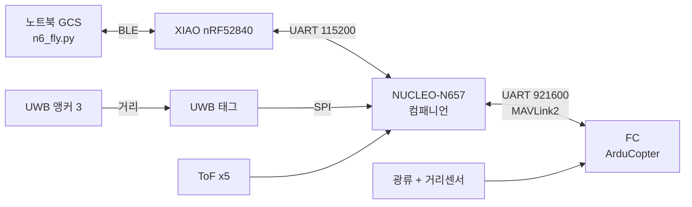

<div align="center">

# 다수 드론 충돌 회피 및 편대 유지 경량 제어


</div>

종합설계 팀 프로젝트(멀티버스)다. 물류센터를 15 m × 15 m 실내로 줄여, 드론 6대가 랜덤 목표점으로 무충돌 이동하는 것이 성공 기준이다. 비싼 센서 없이 UWB, ToF, BLE만으로 위치 추정, 이웃 공유, 충돌 회피를 구현하고, 그 과정에서 연산량과 통신량을 줄인다.

## 목차

- [시스템 구성](#시스템-구성)
- [현재 상태](#현재-상태)
- [빠른 시작](#빠른-시작)
- [대시보드](#대시보드)
- [레포 구조](#레포-구조)
- [문서](#문서)
- [한계](#한계)

## 시스템 구성



| 구분 | 선택 |
| --- | --- |
| 위치 | UWB 앵커 3개로 방 고정 좌표계. 실패 시 고정 ZED 2i |
| 높이 · 속도 · 자세 | 거리센서(높이, `EK3_SRC1_POSZ 2`) + 광류 센서 + FC IMU, FC EKF |
| 지상 ↔ 기체 | BLE (노트북 ↔ XIAO) → NUCLEO 투명 브리지 → FC MAVLink |
| 알고리즘 | A* 경로 + consensus 편대 제어 + CBF-QP 안전 필터 |
| 경량화 | 이벤트 트리거로 통신 빈도 축소, 알고리즘 C99 포팅(N6 탑재용) |

## 현재 상태

기준일 2026-11-25. 작업 마감 12/3, 종강 제출 12/14(예정). 전체 체크리스트는 [진행 현황](docs/진행현황.md), 기체별로 올라간 코드는 [VERSIONS.md](VERSIONS.md).

| 영역 | 상태 |
| --- | --- |
| 기체 비행 | 4호기가 거리센서 높이(`POSZ 2`)로 저고도 호버를 유지했다(11-23). 이 값은 공통 파라미터로 옮겼다. 11-24에는 4호기에서 노트북 → FC 방향 UART 잡음을 발견했다. 배선 점검이 필요하다 |
| 기체 준비 | 1·3·4·5호기 FC 4.7.3과 공통 파라미터를 확인했다. 3호기는 프롭 없는 안전 시험을 통과했고 호버 시험을 기다린다. 5호기는 납땜 수리 뒤 다시 점검한다. 2·6호기는 확인 전이다 |
| 지상 도구 | `n6_fly.py`: 이륙, 호버, 무기한 유지(`--hold`), 제자리 회전(`--yaw`), 자세 기록, 킬 키, 링크 단절 시 착륙. `n6_fly_multi.py`: 여러 대 동시 연결 |
| UWB | 앵커 3대 + 태그 삼변측량에서 바닥 높이 수평 오차 4.5~7.9 cm(보정 전). A1·A2 안테나 지연을 보정한 뒤 지점 2·4에서 레이저와 2 cm 이내 |
| 알고리즘 | 파이썬 baseline(A*, consensus, CBF-QP, APF, 이벤트 트리거, 2D 시뮬)과 C99 포팅 완료. N6 시간 측정 펌웨어(`n6_algo_bench`)는 빌드만 했고 보드에서는 아직 돌리지 않았다 |
| 벤치 | Task 1(UWB) · 3(N6) · 4(BLE) Lv2 완료. 원자료는 [drone-hw-bench](https://github.com/Multi-Bus/drone-hw-bench) |

다음 할 일: 4호기 배선 수리 후 재측정 → 3호기 호버 → UWB 위치를 FC에 넣어 비행 → N6에서 CBF-QP 시간 측정 → 2대 충돌 회피.

## 빠른 시작

모든 명령은 레포 루트에서 실행한다.

```powershell
pip install -r gcs/tools/requirements.txt
```

호버 시험. 기체 점검 순서와 안전 수칙은 [호버링 시험 절차](docs/호버링_시험_절차.md)를 먼저 읽는다.

```powershell
python gcs/tools/n6_fly.py --name N6-DRONE-4 --alt 1.3 --hold
```

시험 (파이썬 알고리즘 · C 포팅 · 대시보드, `n6_fly.py` 오프라인 시나리오, UWB 프로토콜):

```powershell
python -m pytest -q
```

```powershell
python gcs/tools/dev/sim_test.py
```

```powershell
cd firmware/uwb/protocol; gcc -std=c99 -Wall -Wextra -Iinclude -o test/test_uwb_protocol test/test_uwb_protocol.c src/uwb_protocol.c -lm; test/test_uwb_protocol
```

2D 시뮬:

```powershell
python -m swarm.simulator --scenario swap --avoid cbf --comm event --delta 0.1
```

## 대시보드

발표용 편대 리모트 화면(가상 모드)이다. 버튼으로 시작, 중지, 편대 변경을 명령하고, 바닥을 클릭해 목표와 장애물을 정하면 편대가 A* 경로로 장애물을 피해 이동한다. `python -m gcs.dashboard`로 띄운다. 설치와 조작은 [gcs/dashboard/README.md](gcs/dashboard/README.md).


## 레포 구조

```
README.md
VERSIONS.md          기체별로 올라간 버전표
firmware/            기체에 올리는 것
  fc/                ArduCopter 파라미터(base/, drones/), 변경 전 백업(backups/), 적용 스크립트(setup/)
  nucleo/            NUCLEO-N657 UART 브리지 소스(n6_bridge/), 배포 바이너리(release/)
                     n6_algo_bench/: swarm/c 알고리즘 시간 측정 펌웨어 (Task 3 Lv3)
  xiao/              XIAO nRF52840 BLE 릴레이 (v1, v2)
  uwb/               UWB 프로토콜 C99(protocol/), DWM3001CDK 앵커 펌웨어(anchor_dwm3001_3to1/),
                     벤치(bench_3toN/), 측정 결과(results/), airtime 예산(scripts/)
gcs/                 노트북(지상국)에서 도는 것
  tools/             n6_fly.py(호버링 실행), n6_fly_multi.py(여러 대),
                     diag/(FC · BLE 점검), analysis/(FC 로그 분석), dev/(오프라인 시험)
  dashboard/         발표용 편대 리모트 대시보드: FastAPI 서버 + three.js 화면
swarm/               파이썬 알고리즘: A*, consensus 편대, CBF-QP · APF 회피, 이벤트 트리거, 2D 시뮬
  c/                 같은 알고리즘의 C99 포팅 (N6 탑재용)
tests/               swarm, swarm/c, dashboard 시험
docs/                설계 · 하드웨어 · 소프트웨어 문서, 시험 절차, 발표, 회의록 (아래 표)
```

## 문서

| 폴더 | 문서 | 내용 |
| --- | --- | --- |
| | [진행 현황](docs/진행현황.md) | 체크리스트, 타임라인, 남은 일, 위험 |
| | [호버링 시험 절차](docs/호버링_시험_절차.md) | 기체 점검, 광류 · 모터 · 안전 시험, 시험 비행 절차와 기록 (팀 공유용) |
| [설계](docs/설계) | [01 시스템 구조도](docs/설계/01_시스템_구조도.md) | 전체 시스템, 기체 내부 데이터 흐름 · 전처리, 안전 계층, 좌표계 (Mermaid) + [클릭형 HTML](docs/설계/01_시스템_구조도.html), [개선 선택지 지도](docs/설계/개선선택지_지도.html) |
| [하드웨어](docs/하드웨어) | [01 부품 목록](docs/하드웨어/01_부품_목록.md) | 구매 현황, 기체 1대 구성, 부품별 역할. 주문 시트 [주문리스트.xlsx](docs/하드웨어/주문리스트.xlsx) |
| | [02 센서 연동성](docs/하드웨어/02_센서_연동성.md) | 16개 연결 판정, 센서 간 의존 |
| | [03 부품별 입출력과 연산](docs/하드웨어/03_부품별_입출력과_연산.md) | 부품별 input / output, 소프트웨어 연산, UWB 갱신율, 데이터 경로 |
| | [04 전처리 보정](docs/하드웨어/04_전처리_보정.md) | 센서별 보정과 전처리, 시계 동기 |
| | [05 지연 분석](docs/하드웨어/05_지연_분석.md) | 체인별 지연, UART 예산, 측정 계획 |
| [소프트웨어](docs/소프트웨어) | [01 편대 제어와 충돌 회피](docs/소프트웨어/01_편대제어_충돌회피_알고리즘.md) | Consensus, CBF-QP, 비교 알고리즘 |
| | [충돌회피 · 편대제어 구현계획 v2](docs/소프트웨어/충돌회피_편대제어_구현계획.pdf) | 기여 범위, A* · consensus · 회피 · repair · 이벤트 트리거 층 구조, 진행 단계 |
| | [swarm](swarm/README.md), [swarm/c](swarm/c/README.md), [uwb](firmware/uwb/README.md), [dashboard](gcs/dashboard/README.md) | 알고리즘 baseline과 C99 포팅, UWB 통신 구현, 발표용 대시보드 |
| [발표](docs/발표) | 중간발표, 1주차 통신로직 (pptx) | 발표 자료 |
| [발표/스토리텔링](docs/발표/스토리텔링) | [01 발표 흐름](docs/발표/스토리텔링/01_발표_흐름.md) | 미팅 보고 A 3축 기준 슬라이드 구성, 예상 질문 |
| | [02 환경 구성 근거](docs/발표/스토리텔링/02_환경_구성_근거.md) | 물류센터, 15 m 축소, 좌표계 결정 경과 |
| | [03 부품 선택 이유](docs/발표/스토리텔링/03_부품_선택_이유.md) | 후보 비교, 선택 이유 |
| | [04 알고리즘 선정 이유](docs/발표/스토리텔링/04_알고리즘_선정_이유.md) | CBF-QP, Consensus, 이벤트 트리거 |
| | [05 결과 산출 계획](docs/발표/스토리텔링/05_결과_산출_계획.md) | 단계, 실험, 합격 기준, 실패 시 |
| | [06 참고 사례](docs/발표/스토리텔링/06_참고_사례.md) | 사례와 출처, 확인 수준 |
| | [07 미팅보고 A 설계 결론](docs/발표/스토리텔링/07_미팅보고A_설계_결론.md) | 한 줄 결론, 문서 지도, 설계 결정 요약, 하지 않는 것, 미결정 |
| [회의록](docs/회의록) | 주차별 회의록, 멘토링 보고서 (PDF) | |
| [archive](docs/archive) | [핸드오프](docs/archive/핸드오프/README_KO.md) | 11/20 Dropbox 인수인계 문서. 코드 출처 기록용이며 지금 코드와 다를 수 있다 |

## 한계

- 호버는 4호기 저고도에서만 확인했다. 여러 대 비행, UWB 위치 입력 비행, 충돌 회피 비행은 아직 없다.
- UWB 위치 정확도는 정지한 태그로만 쟀다. 통과 기준(위치 RMSE 0.15 m)을 비행 중에 확인하지 않았다.
- 지연 예산과 안전 여유 수치 대부분은 계산 · 가정이다. 실기체 시험으로 교체해야 한다.
- 알고리즘의 N6 실행 시간은 아직 재지 않았다(PC 시간만 있음).
- 기체별로 올라간 코드는 일부만 확인했다. 나머지는 [VERSIONS.md](VERSIONS.md)에서 "미확인"이다.
- 11-10 교수 미팅 결정 사항은 정리되지 않았다.
