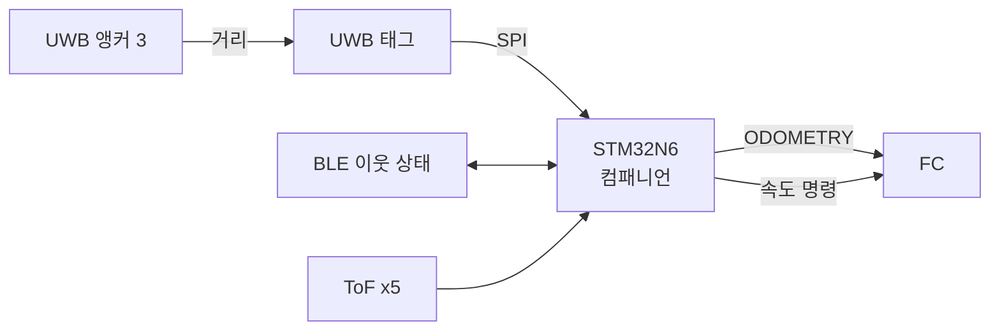
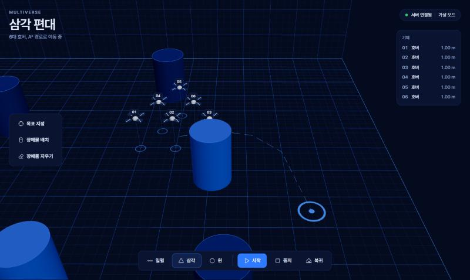

<div align="center">

# 다수 드론 충돌 회피 및 편대 유지 경량 제어


</div>

종합설계 팀 프로젝트다. 물류센터를 15 m × 15 m 실내로 줄여, 드론 6대가 랜덤 목표점으로 무충돌 이동하는 것이 성공 기준이다. 비싼 센서 없이 UWB, ToF, BLE만으로 위치 추정, 이웃 공유, 충돌 회피를 구현하고, 그 과정에서 연산량과 통신량을 줄인다.

## 목차

- [시스템 구성](#시스템-구성)
- [현재 상태](#현재-상태)
- [대시보드](#대시보드)
- [문서](#문서)
- [레포 구조](#레포-구조)
- [한계](#한계)

## 시스템 구성



| 구분 | 선택 |
| --- | --- |
| 위치 | UWB 앵커 3개로 방 고정 좌표계. 실패 시 고정 ZED 2i |
| 속도 · 자세 | 광류 센서 + FC IMU, FC EKF |
| 통신 | BLE (XIAO nRF52840 ↔ 동글). 드론 ↔ 드론 교환 방식은 미정 |
| 알고리즘 | 편대 제어 + CBF-QP 안전 필터 |
| 경량화 | 이벤트 트리거로 통신 빈도 축소 |

## 현재 상태

기준일 2026-11-21 (10주차). 종강 제출 12/14(예정). 전체 체크리스트는 [진행 현황](docs/진행현황.md).

| 영역 | 상태 | 진행 |
| --- | --- | --- |
| 기획 · 설계 | 좌표계(UWB 앵커 3), 알고리즘(편대 + CBF-QP), 실험 E1 ~ E6 확정 | 완료 |
| 부품 | 핵심 부품 구매 완료. 모터 4개, 프롭 1세트 부족 | 진행 중 |
| UWB 거리 | LOS 오차 2 cm 안팎, 가림 +29 ~ 36 cm. 위치 RMSE는 검증 전 | Task 1 Lv2 |
| BLE 링크 | 50 Hz × 64 B 손실 0. RTT 26 ~ 180 ms (연결 간격에 따라). 드론 ↔ 드론은 미정 | Task 4 Lv2 |
| N6 | 기초 실시간 측정 완료. CBF-QP는 미측정 | Task 3 Lv2 |
| 센서 연동 | 16개 연결 중 실측 2, 확인 1, 추정 9, 미확인 3, 문제 1 | 문서 완료, 실물 전 |
| 소프트웨어 | BLE 링크, NUCLEO 브리지, 호버링 실행 도구(`n6_fly.py`) 구현. 알고리즘 baseline(`swarm/`, 2D 시뮬)과 UWB 프로토콜 계층(`uwb/`, PC 테스트) 구현. 기체 탑재 전 | 진행 중 |
| 기체 비행 | 1호기, 4호기 브리지와 FC 설정 확인. 4호기 호버링 시험 중이며 이륙은 되나 고도 유지에 실패한다. 로그로 기압계 높이가 프롭 바람에 틀어지는 것을 확인했고, 높이 소스를 거리센서로 바꿔 재시험 중이다. 속도 추종 지연 실측은 아직 | 진행 중 |

```
기획·설계 ████████░░ 대부분 완료   벤치 ████░░░░░░ Task 1·3·4 Lv2
소프트웨어 ████░░░░░░ 시뮬 baseline 기체·비행 ██░░░░░░░░ 호버링 시험 중
```

가장 먼저 할 일: 4호기 호버링 고도 유지 해결 → 속도 추종 지연 실측 → EVB 레인징 · API 포팅(Task 2) → ToF 5개(Task 5) → CBF-QP 시간(Task 3 Lv3).

## 대시보드

발표용 편대 리모트 화면(가상 모드). 버튼으로 시작, 중지, 편대 변경을 명령하고, 바닥을 클릭해 목표와 장애물을 정하면 편대가 A* 경로로 장애물을 피해 이동한다. 실행과 조작은 [dashboard/README.md](dashboard/README.md).



## 문서

| 폴더 | 문서 | 내용 |
| --- | --- | --- |
| [설계](docs/설계) | [01 시스템 구조도](docs/설계/01_시스템_구조도.md) | 전체 시스템, 기체 내부 데이터 흐름 · 전처리, 안전 계층, 좌표계 (Mermaid) + [클릭형 HTML](docs/설계/01_시스템_구조도.html) |
| [하드웨어](docs/하드웨어) | [01 부품 목록](docs/하드웨어/01_부품_목록.md) | 구매 현황, 기체 1대 구성, 부품별 역할 |
| | [02 센서 연동성](docs/하드웨어/02_센서_연동성.md) | 16개 연결 판정, 센서 간 의존 |
| | [03 부품별 입출력과 연산](docs/하드웨어/03_부품별_입출력과_연산.md) | 부품별 input / output, 소프트웨어 연산, UWB 갱신율, 데이터 경로 |
| | [04 전처리 보정](docs/하드웨어/04_전처리_보정.md) | 센서별 보정과 전처리, 시계 동기 |
| | [05 지연 분석](docs/하드웨어/05_지연_분석.md) | 체인별 지연, UART 예산, 측정 계획 |
| [호버링 시험](docs/호버링_시험_절차.md) | [호버링 시험 절차](docs/호버링_시험_절차.md) | 기체 점검, 광류 · 모터 · 안전 시험, 시험 비행 절차 (팀 공유용). 기체별 버전은 [VERSIONS.md](VERSIONS.md) |
| [소프트웨어](docs/소프트웨어) | [01 편대 제어와 충돌 회피](docs/소프트웨어/01_편대제어_충돌회피_알고리즘.md) | Consensus, CBF-QP, 비교 알고리즘 |
| | [충돌회피 · 편대제어 구현계획 v2](docs/소프트웨어/충돌회피_편대제어_구현계획.pdf) | 기여 범위, A* · consensus · 회피 · repair · 이벤트 트리거 층 구조, 진행 단계 |
| | [swarm](swarm/README.md), [uwb](uwb/README.md), [dashboard](dashboard/README.md) | 트랙 A 알고리즘 baseline 코드, 트랙 B UWB 통신 구현 가능성 확인 코드, 발표용 편대 리모트 대시보드(가상 모드) |
| [스토리텔링](docs/스토리텔링) | [01 발표 흐름](docs/스토리텔링/01_발표_흐름.md) | 미팅 보고 A 3축 기준 슬라이드 구성, 예상 질문 |
| | [02 환경 구성 근거](docs/스토리텔링/02_환경_구성_근거.md) | 물류센터, 15 m 축소, 좌표계 결정 경과 |
| | [03 부품 선택 이유](docs/스토리텔링/03_부품_선택_이유.md) | 후보 비교, 선택 이유 |
| | [04 알고리즘 선정 이유](docs/스토리텔링/04_알고리즘_선정_이유.md) | CBF-QP, Consensus, 이벤트 트리거 |
| | [05 결과 산출 계획](docs/스토리텔링/05_결과_산출_계획.md) | 단계, 실험, 합격 기준, 실패 시 |
| | [06 참고 사례](docs/스토리텔링/06_참고_사례.md) | 사례와 출처, 확인 수준 |
| | [07 미팅보고 A 설계 결론](docs/스토리텔링/07_미팅보고A_설계_결론.md) | 한 줄 결론, 문서 지도, 설계 결정 요약, 하지 않는 것, 미결정 |
| | [진행 현황](docs/진행현황.md) | 체크리스트, 타임라인, 남은 일, 위험 |

## 레포 구조

```
README.md
docs/
  설계/          시스템 구조도 (다이어그램)
  하드웨어/      부품, 연동성, 입출력 · 연산, 전처리, 지연
  소프트웨어/    편대 제어 · 충돌 회피 알고리즘
  스토리텔링/    최종 발표 흐름, 근거, 미팅 보고 A 설계 결론
  진행현황.md    체크리스트
  회의록/        주차별 회의록 PDF
  files/         주문리스트.xlsx, 개선선택지_지도.html
  호버링_시험_절차.md   호버링 시험 절차 (팀 공유용)
  핸드오프/      팀 인수인계 문서
nucleo/          NUCLEO(STM32N657) UART 브리지 소스, release/에 배포 바이너리
xiao/            XIAO nRF52840 BLE 릴레이 (v1, v2)
fc/              ArduCopter 파라미터(base, drones/) 와 적용 스크립트(setup/)
tools/           PC 도구: n6_fly.py(호버링 실행), hover_test/(점검 스크립트)
swarm/           트랙 A 파이썬: A*, consensus 편대, CBF-QP · APF 회피, 이벤트 트리거, 2D 시뮬
tests/           swarm, dashboard 테스트
uwb/             트랙 B C99: UWB 패킷 · TDMA · 조정자 배정(include/, src/, test/), airtime 예산(scripts/)
dashboard/       발표용 편대 리모트 대시보드(가상 모드): FastAPI 서버 + three.js 화면
VERSIONS.md      기체별로 올라간 버전표
```

```powershell
python tests/test_swarm.py
```

```powershell
python -m swarm.simulator --scenario swap --avoid cbf --comm event --delta 0.1
```

실측 코드와 원자료는 이 레포에 없고 별도 레포 [drone-hw-bench](https://github.com/Multi-Bus/drone-hw-bench)에 있다.

## 한계

- 지연 예산과 안전 여유 수치 대부분은 계산 · 가정이다. 실기체 시험으로 교체해야 한다.
- UWB 위치 정확도(통과 기준 RMSE 0.15 m)는 아직 검증 전이다.
- 일부 실측(UWB, N6)은 팀 Notion 보고에서 옮겼고 원자료 정리 중이다.
- 11-10 교수 미팅 결정 사항은 정리되지 않았다.
- 호버링은 아직 성공하지 못했다. 4호기에서 이륙 후 고도를 유지하지 못한다.
- 기체별로 올라간 코드 버전은 1호기와 4호기만 확인했다. 나머지는 [VERSIONS.md](VERSIONS.md)에서 "미확인"이다.
