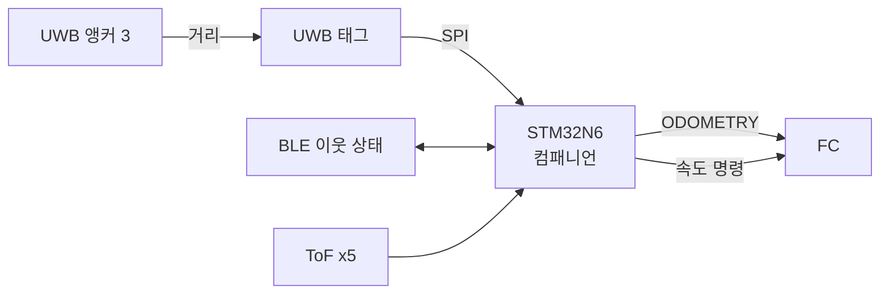

<div align="center">

# 멀티버스

**GPS 없는 실내에서 드론 6대가 서로 부딪히지 않고 움직이게 하는, 가벼운 제어 시스템.**


</div>

종합설계 팀 프로젝트다. 물류센터를 15 m × 15 m 실내로 줄여, 드론 6대가 랜덤 목표점으로 무충돌 이동하는 것이 성공 기준이다. 비싼 센서 없이 UWB, ToF, BLE만으로 위치 추정, 이웃 공유, 충돌 회피를 구현하고, 그 과정에서 연산량과 통신량을 줄인다.

## 목차

- [시스템 구성](#시스템-구성)
- [현재 상태](#현재-상태)
- [문서](#문서)
- [레포 구조](#레포-구조)
- [한계](#한계)

## 시스템 구성



| 구분 | 선택 |
| --- | --- |
| 위치 | UWB 앵커 3개로 방 고정 좌표계. 실패 시 고정 ZED 2i |
| 속도 · 자세 | 광류 센서 + FC IMU, FC EKF |
| 통신 | BLE (XIAO nRF52840 ↔ 동글) |
| 알고리즘 | 편대 제어 + CBF-QP 안전 필터 |
| 경량화 | 이벤트 트리거로 통신 빈도 축소 |

## 현재 상태

기준일 2026-11-16.

| 영역 | 상태 |
| --- | --- |
| 부품 | 핵심 부품 구매 완료. 모터 4개, 프롭 1세트 부족 |
| UWB 거리 | LOS 오차 2 cm 안팎, 가림 +29 ~ 36 cm |
| BLE 링크 | 50 Hz × 64 B 손실 0. RTT 26 ~ 180 ms (연결 간격에 따라) |
| N6 | 기초 실시간 측정 완료. CBF-QP는 미측정 |
| 기체 비행 | 시험 전. 속도 추종 지연 τ 실측이 첫 과제 |

## 문서

| 문서 | 내용 |
| --- | --- |
| [1-설계](docs/1-설계.md) | 목표, 시스템 구성, 핵심 결정, 안전 여유, 실험 설계, 미결정 |
| [2-하드웨어](docs/2-하드웨어.md) | 부품과 금액, 연동성, 실측 결과 |
| [3-소프트웨어](docs/3-소프트웨어.md) | 데이터 흐름, 모듈, 설정값, 지연 예산 |
| [4-진행](docs/4-진행.md) | 타임라인, 남은 일, 위험 |
| [5-발표](docs/5-발표.md) | 발표 시나리오와 예상 질문 |

## 레포 구조

```
README.md
docs/
  1-설계.md  2-하드웨어.md  3-소프트웨어.md  4-진행.md  5-발표.md
  회의록/     주차별 회의록 PDF
  files/      주문리스트.xlsx, 개선선택지_지도.html, 1주차 발표 pptx
```

실측 코드와 원자료는 별도 레포 [drone-hw-bench](https://github.com/Multi-Bus/drone-hw-bench)에 있다.

## 한계

- 지연 예산과 안전 여유 수치 대부분은 계산 · 가정이다. 실기체 시험으로 교체해야 한다.
- UWB 위치 정확도(통과 기준 RMSE 0.15 m)는 아직 검증 전이다.
- 일부 실측(UWB, N6)은 팀 Notion 보고에서 옮겼고 원자료 정리 중이다.
- 11-10 교수 미팅 결정 사항은 정리되지 않았다.
