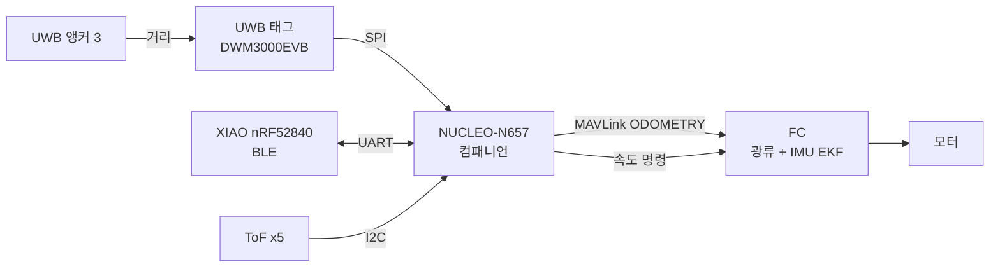

# 1. 설계

## 목표와 성공 기준

- 주제: 다수 드론의 충돌 회피와 편대 유지를 가볍게 제어하기 (연산량, 통신량 절감)
- 환경: 물류센터 실내를 15 m × 15 m 로 축소한 공간 (GPS 없음)
- 성공 기준(지도교수): 드론 6대가 랜덤 목표점으로 이동해 무충돌로 도달
- 방침: 새 알고리즘 개발보다 실기체 제작과 시스템 완성도가 우선

## 시스템 구성



| 구분 | 선택 | 역할 |
| --- | --- | --- |
| 내 위치 | UWB 앵커 3개 + 기체 태그 | 방 고정 좌표계의 (x, y) |
| 속도 · 자세 | MTF-01(광류 + 하향 거리) + FC IMU | FC EKF가 융합 |
| 이웃 상태 | BLE (XIAO nRF52840, PC 동글) | 위치 · 속도 방송, 수신 측에서 외삽 |
| 장애물 | VL53L1X ToF 5개 (앞 · 뒤 · 좌 · 우 · 위) | CBF 장애물 제약, FC 근접 회피 |
| 계산 | NUCLEO-N657X0-Q (STM32N6) | 편대 제어, CBF-QP, MAVLink |

## 핵심 결정

| 결정 | 내용 | 근거 |
| --- | --- | --- |
| 좌표계 | UWB 앵커 3개가 월드 프레임을 정의. A0(0, 0), A1(L, 0), A2(0, L)를 줄자와 레이저 거리계로 실측 | 6대가 같은 좌표계를 써야 상대 위치 계산 가능 |
| 폐기안 | 천장 360° 카메라 (시야각, 정확도 한계) | 6주차 회의 |
| 대안 | 고정 ZED 2i. 보유 3대라 8 m × 8 m 한계. UWB 시험 실패 시 전환 | 9주차 회의 |
| 통과 기준 | UWB 거리 RMSE ≤ 0.10 m, 위치 RMSE ≤ 0.15 m | 9주차 회의 |
| 알고리즘 | 편대 제어가 만든 속도 `v_nom`을 CBF-QP가 최소한으로 보정해 `v_safe` 출력 | 안전 > 편대 유지 > 목표 도달 |
| 비교군 | 편대: Leader-Follower, Virtual Structure, Consensus. 회피: APF, ORCA, MPC(TinyMPC), CBF | 지도교수가 CBF/APF와 AI 결합 비교군을 승인 |
| 경량화 | 통신 빈도 축소(이벤트 트리거)를 우선 | 지도교수 추천 우선순위 |

## 안전 여유 (D_eff)

CBF는 이웃의 실제 위치를 안다고 가정한다. 실제로는 오차가 있어 안전거리에 오차 상한을 더한다.

```
D_eff,j = D_base + ε_self + ε_nbr,j
ε_nbr,j = δ(트리거 임계값) + ε_sync          (정보가 낡으면 v_max · AoI 로 교체)
```

| 항 | 값(가정) | 근거 |
| --- | --- | --- |
| D_base | 0.40 m | 시뮬 가정 (충돌은 0.3 m 미만으로 정의, 두 값 정합 필요) |
| ε_self, ε_nbr | 각 0.15 m | UWB 위치 RMSE 통과 기준 |
| 지연 항 | 0.14 m (BLE 간격 7.5 ms) ~ 0.44 m (100 ms) | 상대속도 2 m/s × 이웃 정보 나이 |
| ε_sync | 0.01 m | 2 m/s × 5 ms |
| 합계 | 약 0.85 m ~ 1.15 m | 6대에게 큰 값이라 교착 위험 동반 |

속도 추종 지연 τ(시뮬 가정 0.2 ~ 1.0 s)는 위치 오차가 아니라 모델 오차다. 실기체 측정 전에는 margin을 확정할 수 없다. 대응은 `v_max` 하향이다.

## 실험 설계 (E1 ~ E6)

한 번에 한 요인만 바꾼다.

| 실험 | 바꾸는 요인 |
| --- | --- |
| E1 | 통신 방식: 20 Hz 주기 방송(기준선), 이벤트 트리거, 중앙 우선순위 |
| E2 | 이벤트 임계값 |
| E3 | 통신 지연 |
| E4 | 센서 구성 |
| E5 | 규모(기체 수) |
| E6 | 회피 방식 |

기록 지표: 안전(충돌 횟수 · 성공률, 안전 위반 비율, 최소 이격 거리), 정확도(편대 오차, 복귀 시간), 경량화(통신량, 계산 시간, 메모리, 전력).

## 환경 근거

- 선행 연구(Apostolidis 외, 2022) 시뮬레이션: 넓은 영역 소요 시간이 1대 257.05분에서 9대 54.28분으로 감소.
- 기체가 늘면 간섭도 늘어 편대 제어와 회피가 필요하고, 비행 시간이 길수록 필요한 기체 수가 줄어 경량화가 필요.
- 개선 방향 선택지 지도: [files/개선선택지_지도.html](files/개선선택지_지도.html)

## 미결정

| 항목 | 상태 |
| --- | --- |
| z 소스 | 앵커 3개로는 2D만 가능. 기압, MTF-01 고도, 4번째 앵커 중 선택 |
| yaw 소스 | 실내 컴퍼스 신뢰 불가. 미정 |
| 앵커 수 | 3개 확정이나 4개면 잔차 검사 가능. 팀 합의 필요 |
| 15 m 규모 유효 거리 | UWB 미검증 |
| 회피 방식 · 평가 방식 | 정지 / 우회 / 고도 분리, 시뮬 vs 실기체 미정 |
| 시험 참값 · 로그 | 비행 중 최소 거리 측정법, 시각 동기, 로그 형식 미정 |
