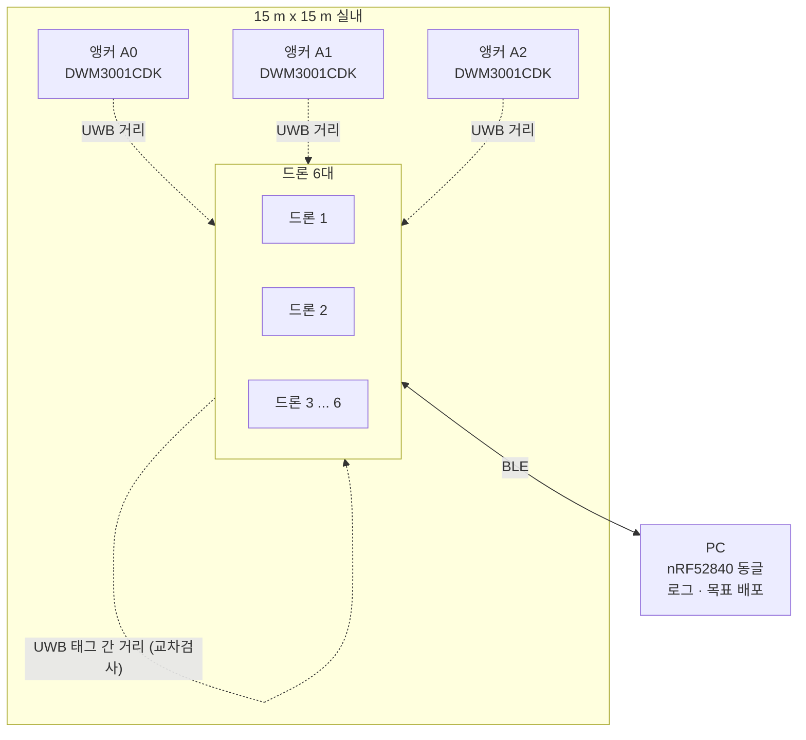
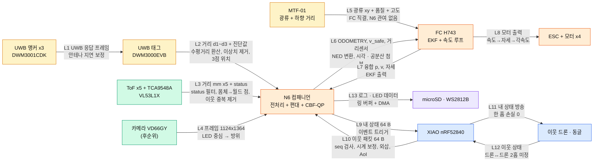
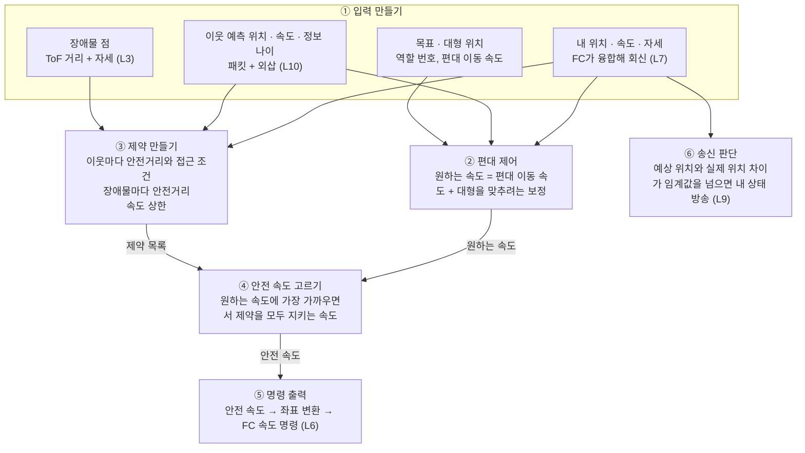
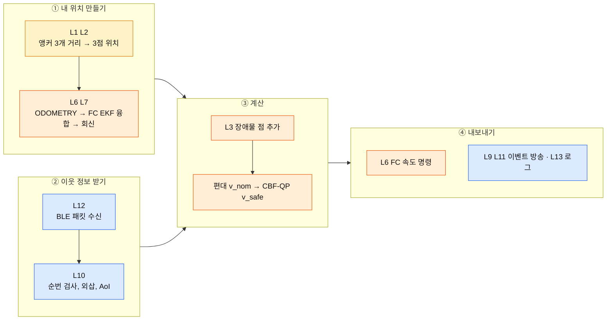
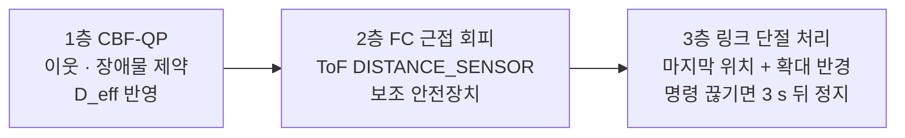

# 시스템 구조도

드론 전반의 설계 구조를 그림으로 정리한다. 모든 그림은 Mermaid라 GitHub와 VS Code 미리보기에서 렌더링된다.

## 1. 전체 시스템 (방 + 6대 + 앵커 + PC)



- 앵커는 방 모서리에 고정하고 좌표는 실측값으로 둔다. 이 3점이 6대 공통 좌표계다.
- BLE는 별모양(중앙 1 + 주변 다수)이라 드론 ↔ 드론 교환은 동글을 거치는 2홉이 된다. 구조는 미결정이다.

## 2. 기체 내부: 부품, 연결, 데이터, 전처리

같은 내용을 클릭형으로 보려면 [HTML 판](01_시스템_구조도.html)을 내려받아 연다. 아래는 GitHub에서 바로 보이는 정적 판이다. 선택해서 펼치는 기능만 없고, 그림과 표의 내용은 같다.

### 2.1 부품 연결과 데이터 흐름

화살표 위 글은 "보내는 데이터 / 전처리"다. 색은 영역이다: 노랑 = 위치, 초록 = 장애물, 파랑 = 통신, 주황 = 제어, 보라 = 기록. 점선 상자는 기체 밖이다. 연결 코드(L1 ~ L13)는 2.2 표와 같다.



이웃 정보 교환(L9 ~ L12)은 **현재 BLE 기준**이다. UWB 페이로드 시험 결과가 나오면 UWB 방식으로 바꿀지 판단해 이 그림을 수정한다.

### 2.2 연결별 데이터와 전처리

상태: 실측 = 벤치 측정, 확인 = 문서 출처, 추정 = 계산 · 가정, 미확인 = 시험 전.

| 코드 | 구간 | 데이터 형태 | 전처리 순서 | 주기 | 상태 |
| --- | --- | --- | --- | --- | --- |
| L1 | UWB 앵커 ×3 → UWB 태그 | UWB 무선 프레임. 태그가 앵커 3개와 차례로 거리를 잰다. | 1. 안테나 지연은 모듈마다 시작 전 1회 보정<br>2. 앵커 좌표는 줄자 · 레이저로 실측, 쌍 거리 3개로 검증<br>3. 시간 분할(TDMA) 없이 각자 재면 충돌한다 | 11~33 Hz (추정) | 실측 |
| L2 | UWB 태그 → N6 컴패니언 | SPI 타임스탬프에서 거리 d_k (k=1~3, m), 수신 진단값(첫 경로 전력 등). IRQ로 알림. | 1. 수평거리 환산: 높이 차 dz를 빼서 √(d²−dz²). dz는 MTF-01 고도를 쓴다 (센서 간 가장 중요한 의존)<br>2. 이상치 제거: 진단값으로 NLOS 의심 거리를 버리고, 직전 예측과 잔차가 크면 버린다 (게이팅)<br>3. 3점 최소제곱(가우스-뉴턴), 초기값은 직전 위치. 앵커가 3개라 잔차 검사는 불가<br>4. 평균 필터는 쓰지 않는다. 3점 평균은 20 Hz에서 50 ms 지연. 평활은 FC EKF에 맡긴다<br>5. 측정 시각(교환 중간)과 공분산을 붙여 ODOMETRY로 내보낸다 | 11~33 Hz (추정) | 추정 |
| L3 | ToF ×5 + MUX → N6 컴패니언 | I2C. 센서마다 거리(mm), range_status, 신호율. 같은 주소(0x29) 5개를 TCA9548A로 채널 분리. | 1. range_status ≠ 0이면 버린다<br>2. 같은 방향 2회 연속 임계 이내일 때만 장애물 (오경보↓, 1샘플 지연) [제안]<br>3. 거리 → 점: 방향 단위벡터 × 거리 + 센서 오프셋 → 몸체 좌표 → FC 자세로 월드 좌표<br>4. 이웃 외삽 위치 근처(게이트)면 이웃으로 연결, 정지 장애물로 따로 세지 않는다 | 최대 50 Hz. 5개 연속 모드 읽기 약 3 ms (계산) | 미확인 |
| L4 | 카메라 (후순위) → N6 컴패니언 | MIPI CSI-2, 글로벌 셔터 원시 프레임. | 1. 노출 · 게인 · 화이트밸런스 수동 고정 (LED 색 오인식 방지)<br>2. LED 중심 검출 → 왜곡 보정 → 방위 단위벡터 → 노출 중간 시각 자세로 월드 변환<br>3. 점멸 ID는 4비트 10 Hz면 최소 0.4 s | fps 미확인 | 미확인 |
| L5 | MTF-01 → FC | UART 115200 MAVLink. 광류 속도(품질 포함), 하향 거리(고도). | 1. 장착 방향(FLOW_ORIENT_YAW)과 위치 오프셋 설정<br>2. 광류 스케일 계수 보정, 로그의 품질(opt_qua) 확인<br>3. EKF 속도 소스 = 광류. 위치 소스 = ExternalNav (UWB)<br>4. 조도 60 lux 이상, 무늬 없는 바닥은 품질↓ | 최대 100 Hz | 확인 |
| L6 | N6 컴패니언 → FC | MAVLink2 UART. ODOMETRY 약 245 B (20~30 Hz), SET_POSITION_TARGET_LOCAL_NED 약 65 B (20~50 Hz), DISTANCE_SENSOR 약 30 B × 5 (10~50 Hz). | 1. 방 좌표 → NED: x_ned = y_방, y_ned = x_방, z_ned = −z [제안]<br>2. ODOMETRY에 측정 시각과 공분산(품질)을 실어 보낸다<br>3. FC의 센서 지연 파라미터를 실제 지연에 맞춘다. 50 ms 어긋나면 1 m/s에서 5 cm | 20~50 Hz | 추정 |
| L7 | FC → N6 컴패니언 | MAVLink2 UART. UWB 위치 + 광류 속도 + IMU를 EKF가 융합한 상태. | 1. N6가 받아 ToF 점의 월드 변환과 이웃 방송, CBF 입력에 쓴다<br>2. 속도 추종 지연 τ가 이 되돌림에 섞인다 (시뮬 가정 0.2~1.0 s) | FC 설정 | 추정 |
| L8 | FC → ESC · 모터 ×4 | PWM/DShot. FC 내부 루프(속도 50 Hz, 자세 250 Hz, 각속도 1 kHz: PX4 기준, ArduPilot 값 미확인). | 1. N6는 이 루프를 건드리지 않는다. 속도 setpoint만 준다 | 1 kHz급 | 확인 |
| L9 | N6 컴패니언 → XIAO nRF52840 | id, t_tx, p(12 B), v(12 B), seq. N6 ↔ XIAO는 UART로 가정(미확인). | 1. 예측 위치와 실제 위치 오차가 임계값 δ를 넘을 때만 송신<br>2. 시뮬 예: 3000 → 61 메시지 (약 98% 감소). 이상적 시뮬 값<br>3. 패킷 포맷 통일 필요: 31 B × 20 Hz vs 64 B × 50 Hz | 50 Hz 기준선 → 이벤트 시 감소 | 추정 |
| L10 | XIAO nRF52840 → N6 컴패니언 | 수신 프레임 + RSSI. 필드는 id, t_tx, p, v, seq. | 1. seq로 순서 뒤바뀜 · 손실 검출, 낡은 패킷 폐기<br>2. 시계 보정 후 외삽: p̂ = p + v · (t_now − t_tx)<br>3. AoI = t_now − t_last가 T_stale을 넘으면 stale (진입 · 해제 임계값 분리)<br>4. UWB 이웃 거리 d_ij와 ‖p_i − p̂_j‖ 비교로 교차검사 [제안] | 이웃 수 × 방송 주기 | 추정 |
| L11 | XIAO nRF52840 → 이웃 드론 · 동글 | BLE 연결. 처리량 최고 109.5 kB/s, 요구치 3.2 kB/s. | 1. 50 Hz × 64 B: 연결 간격 7.5 / 30 / 100 ms 모두 손실 0 (실측)<br>2. RTT 64 B: 7.5 ms 간격 평균 26.0 ms, 100 ms 간격 평균 179.8 ms<br>3. 거리 1 · 5 · 10 m 손실 0, 20 m는 4회 중 1회 28.9% 부족 | 50 Hz × 64 B | 실측 |
| L12 | 이웃 드론 · 동글 → XIAO nRF52840 | BLE는 별모양(중앙 1 + 주변 다수)이라 드론끼리는 동글을 거치는 2홉이 된다. | 1. 안 가: 동글 중계 (지연 증가, 단일 실패점)<br>2. 안 나: BLE 광고 방송 (최소 20 ms + 무작위 지연, 시험 안 함)<br>3. 안 다: UWB 페이로드 (제품 지원 미확인) | 미정 | 미확인 |
| L13 | N6 컴패니언 → SD · LED 마커 | SPI/SDMMC로 로그, GPIO → SN74AHCT125 → WS2812B로 LED ID. | 1. SD 쓰기는 수십~수백 ms 멈출 수 있어 제어 루프에서 직접 쓰지 않는다<br>2. RAM 링 버퍼에 쌓고 낮은 우선순위에서 DMA로 쓴다 [제안]<br>3. LED는 5 V 전원 + 디퓨저, 4개 전송 약 0.12 ms | 비동기 | 추정 |

핵심 의존 두 가지.

- UWB 수평거리 환산(L2)이 MTF-01 고도(L5, L7)에 의존한다. 고도가 흔들리면 위치도 흔들린다.
- 이웃 위치(L10)는 외삽과 AoI 판정을 거친 뒤에야 CBF에 들어간다. 외삽하지 않으면 상대속도 2 m/s, 2홉 60 ~ 80 ms에서 12 ~ 16 cm 어긋난다 (계산).

### 2.3 N6 내부 소프트웨어 계층: 값의 조합과 연산

N6 안에서 값이 다음 단계로 넘어갈 때 어떤 값들을 조합해서 무슨 연산으로 만드는지 정리한다. 이해가 목적이라 기호 대신 말로 적었다. 식 출처는 [편대 제어와 충돌 회피 알고리즘](../소프트웨어/01_편대제어_충돌회피_알고리즘.md) 2.2절이다. 연산 시간은 모두 미측정이다.



#### ① 입력 만들기: 어떤 값의 조합인가

| 값 | 조합하는 값 | 연산 | 어디서 오는가 |
| --- | --- | --- | --- |
| 내 위치 · 속도 · 자세 | UWB 위치(x, y) + 광류 속도 + IMU | FC가 융합한다. N6는 결과만 회신받는다 | L2 → L6 → FC → L7 |
| 이웃 예측 위치 | 이웃이 보낸 위치, 이웃 속도, 이웃이 보낸 시각, 지금 시각, 시계 오프셋 | 이웃 예측 위치 = 이웃이 보낸 위치 + 이웃 속도 × (지금 시각 − 보낸 시각). 패킷이 도착하는 동안 이웃이 움직인 만큼을 더한다 (외삽) | L10 |
| 정보 나이 | 마지막으로 받은 시각 | 정보 나이 = 지금 시각 − 마지막 수신 시각. 기준을 넘으면 낡은 정보(stale)로 본다 | L10 |
| 장애물 점 | ToF 거리, 센서가 보는 방향, 센서 장착 위치, 내 자세, 내 위치 | 장애물 위치 = 내 위치 + 자세로 돌린 (센서 방향 × 거리 + 센서 장착 위치). status가 정상이 아니면 버린다. 이웃 근처면 이웃으로 연결한다 | L3 |
| 목표 · 대형 위치 | 역할 번호, 역할별 대형 위치 표, 편대 이동 속도 | 이웃과 내 대형 위치의 차이를 계산한다 | 앱 · 리더 방송 (미정) |

#### ② 편대 제어 → ③ 제약 → ④ 안전 속도 고르기

| 단계 | 입력 값 | 연산 | 출력 |
| --- | --- | --- | --- |
| 편대 제어 | 편대 이동 속도, 내 위치, 이웃 예측 위치, 대형 위치 차이, 맞추는 강도 | 원하는 속도 = 편대 이동 속도 + 이웃마다 (맞추는 강도 × (실제 상대 위치 − 대형이 요구하는 상대 위치))를 모두 더한 값. 대형이 이미 맞으면 보정이 0이라 편대 이동 속도만 남는다. 목표점으로 가는 편대 이동 속도 산출식은 [제안]이며 확정 전 | 원하는 속도 |
| 이웃 안전거리 | 기본 거리, 내 위치 오차, 이웃 위치 오차, 상대속도 상한, 정보 나이, 시계 오차 | 안전거리 = 기본 거리 + 내 위치 오차 + 이웃 위치 오차 + 상대속도 상한 × 정보 나이 + 시계 오차. 정보가 낡을수록 거리를 넓힌다 | 이웃별 안전거리 |
| 이웃 접근 조건 | 내 위치, 이웃 예측 위치, 이웃 속도, 안전거리, 여유 감쇠 계수 | 여유 = (내 위치와 이웃 사이 거리)² − 안전거리². 이웃에서 나를 향한 방향으로의 내 속도가 (이웃의 같은 방향 속도 − ½ × 감쇠 계수 × 여유)보다 작아지지 않게 한다. 여유가 작을수록 접근을 더 강하게 막는다 | 이웃별 제약 |
| 장애물 접근 조건 | 내 위치, 장애물 점, 장애물 안전거리 | 이웃과 같은 방식인데 장애물은 정지해 있어서 장애물 속도가 0이다 | 장애물별 제약 |
| 속도 상한 | 최대 속도 | 속도 크기가 최대 속도를 넘지 않게 한다 | 제약 1개 |
| 안전 속도 고르기 | 원하는 속도, 위 제약 전부 | 제약을 모두 지키는 속도 중 원하는 속도에 가장 가까운 것을 고른다 (QP). 제약 수 = 이웃 수 + 장애물 점 수 + 1 | 안전 속도 |
| 해가 없을 때 | 제약이 서로 모순 | 감속하거나 멈춘다. 교착 지표로 센다 | 안전 속도 ≈ 0 |

#### ⑤ 명령과 ⑥ 송신 판단

| 단계 | 입력 값 | 연산 | 출력 |
| --- | --- | --- | --- |
| 명령 출력 | 안전 속도 (방 좌표) | 방 좌표를 FC 좌표(NED)로 바꾼다 [제안]: 북쪽 = 방 y축, 동쪽 = 방 x축, 아래 = −높이. 그다음 MAVLink 속도 명령으로 보낸다 | FC 속도 명령, 20 ~ 50 Hz |
| 송신 판단 | 내 현재 위치, 마지막에 보낸 위치 · 속도 · 시각, 임계값 | 예상 위치 = 마지막에 보낸 위치 + 마지막에 보낸 속도 × 경과 시간. 실제 위치와 예상 위치의 차이가 임계값을 넘으면 송신한다 | 내 상태 64 B 방송 (L9) |

임계값은 이웃 쪽 안전거리에 "이웃 위치 오차"로 더해진다. 통신을 줄일수록 안전거리가 커지는 관계다.

#### 계산 예시 (설명용 가정값)

한 이웃이 내 쪽으로 다가오는 상황이다. 모두 설명용 가정이며 측정값이 아니다.

| 항목 | 값 |
| --- | --- |
| 내 위치 | (0, 0) |
| 이웃 예측 위치 | (1.2, 0), 즉 내 앞 1.2 m |
| 이웃 속도 | (−0.5, 0), 내 쪽으로 0.5 m/s |
| 원하는 속도 | (1.0, 0), 이웃 쪽으로 전진 |
| 안전거리 | 0.85 m |
| 여유 감쇠 계수 | 1 |

```
여유          = 1.2² − 0.85² = 1.44 − 0.7225 = 0.7175
이웃에서 나를 향한 방향 = (−1.2, 0)
허용 기준     = (이웃에서 나를 향한 방향) · (이웃 속도) − ½ × 1 × 0.7175
              = (−1.2)(−0.5) − 0.3588 = 0.2413
조건          = (이웃에서 나를 향한 방향) · (내 속도) ≥ 0.2413
              → −1.2 × (내 x속도) ≥ 0.2413 → 내 x속도 ≤ −0.201
원하는 속도 (1.0, 0) 은 조건을 어긴다
조건을 지키는 속도 중 가장 가까운 것 → 안전 속도 = (−0.201, 0)
```

이웃과 서로 접근해서 안전거리 여유(1.2 − 0.85 = 0.35 m)가 작으면 전진 명령이 후퇴 명령으로 바뀐다. 이웃이 멀거나 멀어지면 조건이 느슨해서 원하는 속도가 그대로 통과한다.

#### 인터페이스와 한계

- 편대 제어와 안전 필터의 인터페이스는 "원하는 속도 → 안전 속도" 함수 하나다. 회피 알고리즘(CBF / ORCA / APF)을 바꿔 끼울 수 있다.
- 속도 명령이 즉시 실현된다고 가정한다. 실제로는 속도 추종 지연만큼 늦어서 안전거리와 최대 속도로 보상한다(지연은 미측정).
- N6용 QP 솔버 선정과 1주기 시간은 미측정이다. 이웃 수에 비례해 제약이 늘어난다.
- 식은 평면(2D)으로 적었다. 3D 확장 여부는 미정이다.

### 2.4 한 제어 주기의 순서



구간별 지연은 [지연 분석](../하드웨어/05_지연_분석.md)에 있다.

## 3. 안전 계층



| 층 | 동작 | 상태 |
| --- | --- | --- |
| 1 | CBF-QP가 `v_nom`을 최소 보정. 정보가 낡으면 D_eff 확대, QP 해 없음 → 감속 | 설계. QP 시간 미측정 |
| 2 | FC가 ToF 거리로 근접 회피. Guided 모드 동작은 [미확인] | 실기 공존 시험 필요 |
| 3 | 이웃 링크 단절 시 마지막 위치 + 확대 반경, GUIDED 명령이 끊기면 3 s 뒤 정지 (ArduPilot) | 설계 |

## 4. 좌표계 배치

```
 y ↑
   │
 A2(0, L) ●─────────────────────
   │                            │
   │       ○ 드론 (x, y)        │     L : 줄자 + 레이저 거리계 실측
   │                            │     NED 변환 : x_ned = y_방, y_ned = x_방, z_ned = -z_위 [제안]
 A0(0, 0) ●────────────────● A1(L, 0) → x
```

- 앵커 3개로는 z를 못 구한다. 거리는 3차원 직선거리라서 MTF-01 고도로 수평거리를 환산해야 한다. 자세한 영향은 [전처리](../하드웨어/04_전처리_보정.md)에 있다.
- 방 프레임 ↔ NED 회전의 기준(yaw)은 아직 정해지지 않았다.
