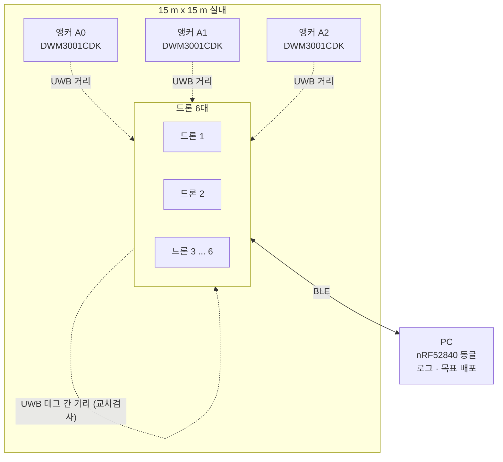
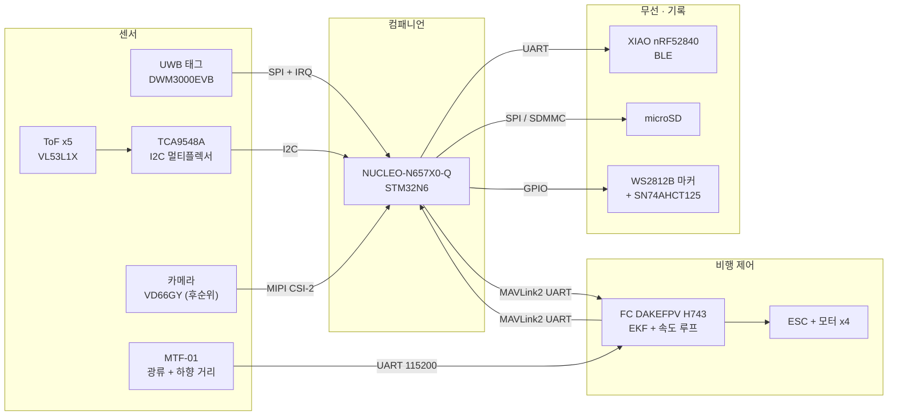
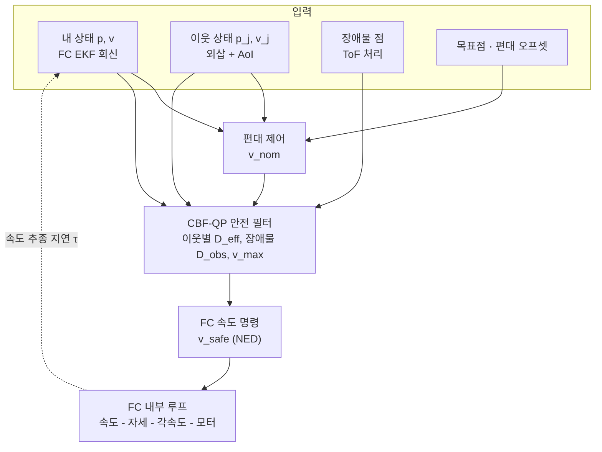
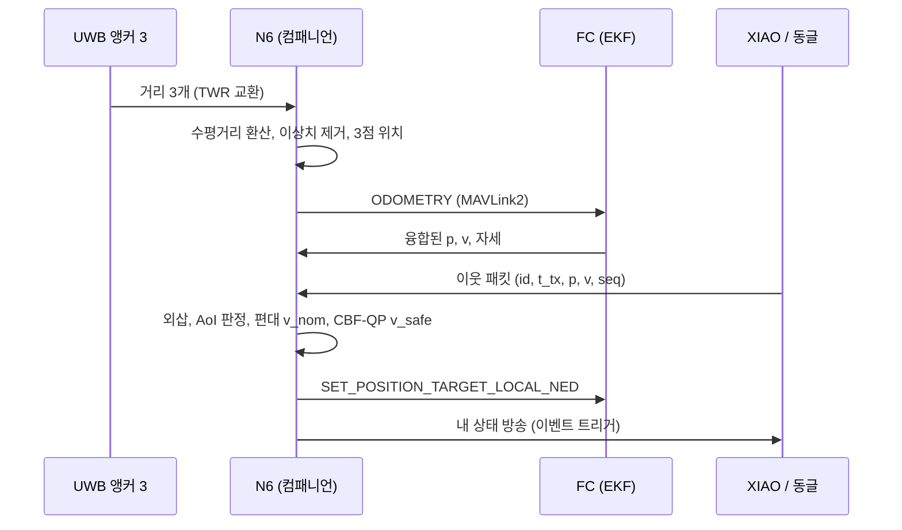

# 시스템 구조도

드론 전반의 설계 구조를 다섯 장의 그림으로 정리한다. 모든 그림은 Mermaid라 GitHub와 VS Code 미리보기에서 렌더링된다.

## 1. 전체 시스템 (방 + 6대 + 앵커 + PC)



- 앵커는 방 모서리에 고정하고 좌표는 실측값으로 둔다. 이 3점이 6대 공통 좌표계다.
- BLE는 별모양(중앙 1 + 주변 다수)이라 드론 ↔ 드론 교환은 동글을 거치는 2홉이 된다. 구조는 미결정이다.

## 2. 기체 1대 하드웨어 블록



- 점선이 아닌 모든 선은 인터페이스가 정해진 연결이다. 전기적 호환은 [센서 연동성](../하드웨어/02_센서_연동성.md)에서 항목별로 판정한다.
- N6 → FC 방향 트래픽은 약 139 kbaud 상당이라 UART는 460800 baud 이상으로 잡는다.

## 3. 소프트웨어 제어 계층



- 편대 제어와 안전 필터의 인터페이스는 `v_nom → v_safe` 함수 하나다. 이렇게 분리하면 회피 알고리즘(CBF / ORCA / APF)을 바꿔 끼울 수 있다.
- 제약을 만족하는 해가 없으면 감속 또는 정지한다.

## 4. 한 제어 주기의 시간 순서



각 구간 지연은 [지연 분석](../하드웨어/05_지연_분석.md)에 있다.

## 5. 안전 계층


| 층 | 동작 | 상태 |
| --- | --- | --- |
| 1 | CBF-QP가 `v_nom`을 최소 보정. 정보가 낡으면 D_eff 확대, QP 해 없음 → 감속 | 설계. QP 시간 미측정 |
| 2 | FC가 ToF 거리로 근접 회피. Guided 모드 동작은 [미확인] | 실기 공존 시험 필요 |
| 3 | 이웃 링크 단절 시 마지막 위치 + 확대 반경, GUIDED 명령이 끊기면 3 s 뒤 정지 (ArduPilot) | 설계 |

## 6. 좌표계 배치

```
 y ↑
   │
 A2(0, L) ●─────────────────────
   │                            │
   │       ○ 드론 (x, y)        │     L : 줄자 + 레이저 거리계 실측
   │                            │     NED 변환 : x_ned = y_방, y_ned = x_방, z_ned = -z_위 [제안]
 A0(0, 0) ●────────────────● A1(L, 0) → x
```

- 앵커 3개로는 z를 못 구한다. 거리는 3차원 직선거리라서 MTF-01 고도로 수평거리를 환산해야 한다. 자세한 영향은 [전처리](../하드웨어/04_전처리_보정.md)에 있다.
- 방 프레임 ↔ NED 회전의 기준(yaw)은 아직 정해지지 않았다.
