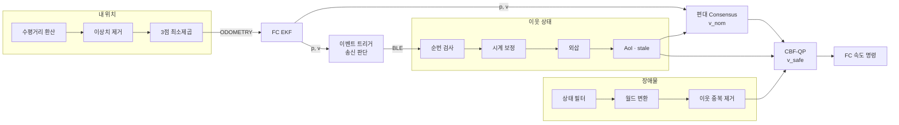

# 알고리즘 목록

각 알고리즘이 어디에 쓰이는지(장치 · 모듈), 지금 어디까지 왔는지 정리한다. 구현된 소프트웨어는 `hw-bench`의 BLE 링크 펌웨어(XIAO, 동글)와 측정 스크립트뿐이고, 나머지는 설계 단계다.

상태: **채택** = 본 구현 대상 / **비교군** = 실험에서 비교 / **보류** = 조건부 / **FC** = FC 펌웨어가 제공

## 1. 목록

| 영역 | 알고리즘 | 하는 일 | 적용 위치 | 판정 |
| --- | --- | --- | --- | --- |
| 내 위치 | 수평거리 환산 | UWB 직선거리에서 높이 차 제거 (MTF-01 고도 입력) | N6 위치 추정 모듈 | 채택 |
| 내 위치 | UWB 이상치 제거 | 수신 진단값(첫 경로 전력) + 직전 예측 대비 잔차 게이팅 | N6 위치 추정 모듈 | 채택. 임계값은 실측 |
| 내 위치 | 3점 최소제곱 (가우스-뉴턴) | 거리 3개 → (x, y). 초기값은 직전 위치 | N6 위치 추정 모듈 | 채택 |
| 내 위치 | 앵커 4개 잔차 검사 | 이상치 한 개가 위치 오차가 되는 문제 완화 | N6 | 보류 (팀 합의 필요) |
| 내 상태 | EKF (UWB 위치 + 광류 속도 + IMU) | 융합 상태 p, v, 자세 | FC | FC |
| 내 위치 | TDMA 슬롯 스케줄 | 6대 + 앵커 3개의 UWB 충돌 방지 | N6 + 동글 비콘 | 채택 (설계 필요) |
| 이웃 상태 | 순번 검사 · 오래된 패킷 폐기 | 손실 · 순서 뒤바뀜 처리 | N6 이웃 상태 모듈 | 채택 |
| 이웃 상태 | 시계 보정 (RTT/2 근사) | 기체 간 타임스탬프 환산 | N6 + 동글 비콘 | 채택 (설계 필요) |
| 이웃 상태 | 등속 외삽 | `p̂ = p + v·(t_now - t_tx)` | N6 이웃 상태 모듈 | 채택 |
| 이웃 상태 | AoI · stale 판정 (히스테리시스) | 낡은 정보 감지, D_eff 확대 | N6 | 채택 |
| 이웃 상태 | UWB 거리 교차검사 | 통신 위치와 태그 간 거리 비교 | N6 | 보류 (태그 간 측거 확정 후) |
| 장애물 | ToF 상태 필터 · 2회 연속 확인 | range_status ≠ 0 폐기, 오경보 감소 | N6 장애물 모듈 | 채택 |
| 장애물 | 몸체 → 월드 변환 | 센서 방향 + FC 자세로 점 생성 | N6 | 채택 |
| 장애물 | 이웃 중복 제거 (게이트) | 이웃을 정지 장애물로 두 번 세지 않음 | N6 | 채택 |
| 편대 | Consensus | 이웃과의 상대 위치가 대형 오프셋과 맞도록 속도 생성. 중앙 조율자 없음 | N6 편대 모듈 | 채택 (기본) |
| 편대 | Leader-Follower | 리더 위치 + 오프셋 추종 | N6 | 비교군 |
| 편대 | Virtual Structure | 편대를 강체로 보고 각자 자리로 이동 | N6 | 비교군 |
| 회피 | **CBF-QP** | `v_nom`을 안전 조건 하에 최소 보정 → `v_safe` | N6 안전 필터 | **채택** |
| 회피 | APF | 목표 인력 + 이웃 척력. 가장 가벼움, 지역최소점 | N6 / 시뮬 | 비교군 |
| 회피 | ORCA | 속도 공간 반평면 제약, 부담 절반씩. 2D 전용 | 시뮬 | 비교군 |
| 회피 | MPC / TinyMPC | 미래 궤적 최적화. TinyMPC는 MCU급 저메모리 솔버 | 시뮬 / N6 | 비교군 |
| 회피 | 교착 탐지 · 완화 | 목표에서 먼데 속도 ≈ 0 지속 시 판정, 우선순위 · 교란 · 목표 재배정 | N6 | 채택 |
| 경량화 | **이벤트 트리거 통신** | 수신측 예측 오차가 δ를 넘거나 T_max 경과 시에만 전송 | N6 송신부 | **채택 (주력)** |
| 경량화 | 이웃 선별 (반경 · TTC · k-최근접 · 공간 해시) | 계산 대상 이웃 수 축소 | 시뮬 | 시뮬 확장성용 (6대에선 효과 거의 없음) |
| 경량화 | 연산 단순화 (거리 제곱 비교 등) | 개별 연산 비용 축소 | N6 | 가능한 것만 |
| 기록 | RAM 링 버퍼 + DMA SD 쓰기 | SD 쓰기 지연이 제어 루프에 영향 주지 않게 | N6 | 채택 |
| 보조 | 학습 기반 정책 (GCBF+ 등), `v_nom` 학습 모델 | AI-1 정책 학습 / AI-2 명목 제어기 학습 + 고전 CBF 필터 | 시뮬 | 보류 (여유 시 비교군) |
| 보조 | LED 마커 검출 · 방위 계산 | 보이는 이웃의 방위 측정 | N6 카메라 | 후순위 |

## 2. 알고리즘 사이의 연결



## 3. 시뮬 비교 결과 (이상적 조건)

6대가 반지름 2 m 원 위에서 정반대편으로 이동, 안전거리 0.4 m, 최대 속도 1 m/s, 1 cm 노이즈. 지연 없음 · 완벽한 위치 · 속도 가정이다.

| 알고리즘 | 차원 | 최소 이격 | 도달 시간 | 최종 오차 |
| --- | --- | --- | --- | --- |
| APF | 2D | 0.416 m | 8.9 s | 0.000 |
| CBF | 2D | 0.469 m | 10.7 s | 0.000 |
| CBF | 3D | 0.485 m | 9.25 s | 0.000 |
| ORCA | 2D | 0.400 m | 7.7 s | 0.000 |

해석:

- 이상적 조건에서는 모두 통과한다. APF가 통과했다고 안전한 것은 아니다(지역최소점 재현: 장애물과 목표가 일직선이면 x = 4.22에서 정지).
- ORCA의 0.400은 안전거리에 딱 닿은 값이다. 여유가 없어 속도 추종 지연 τ ≥ 0.5 s에서 침범했다. CBF는 여유 0.1 m를 두어 τ = 1.0 s에서도 최소 이격 0.406 m를 지켰다.
- CBF는 차원 무관이라 3D에 같은 코드를 쓴다. ORCA는 2D 전용이다.
- 이 값은 파이썬 시뮬이며 실기체 성능이 아니다. 시뮬 코드는 학습용 구현(Dykstra 교대 사영)이고 N6용 QP 솔버는 아직 정하지 않았다.

## 4. 경량화 방법별 위치

| 축 | 줄이는 대상 | 이 프로젝트에서 | 근거 |
| --- | --- | --- | --- |
| A. 알고리즘 대체 | 문제 난이도 | 직접 개발 안 함. 3종 + TinyMPC를 비교군으로 측정 | 교수: 대학원 수준 |
| B. 문제 크기 축소 | 이웃 수 | 시뮬에서 대수를 늘려 확장성 곡선 | 6대에선 효과 거의 없음 |
| C. 연산 단순화 | 개별 연산 | 쉬운 것만 | |
| D. 하드웨어 가속 | 연산 장치 | 보류 | 교수: 만들어 보고 판단 |
| **E. 통신 · 실행 빈도 축소** | **전송 횟수** | **주력** | 교수 추천: "언제 위치 정보를 주고받아야 하는지 조건 연구" |

### 이벤트 트리거 동작

```
송신 측: 마지막으로 보낸 (위치, 속도, 시각)을 기억하고 수신 측 예측을 자기도 계산한다.
         실제 위치와 예측 위치 차이 > δ  또는  마지막 전송 후 시간 > T_max  →  새로 전송
수신 측: 받은 값으로 계속 외삽한다.
```

- 시뮬 예: 60초 비행에서 50 Hz 주기 전송 3000회 vs 이벤트 트리거 61회, 약 98% 감소, 최대 오차 0.149 m (δ = 0.15 m). 운동이 매끄러운 경우이므로 급회피에서는 절감률이 크게 떨어진다. 실제 회피 시나리오에서 재측정해야 한다.
- 메시지 없음 ≠ 변화 없음. 링크 단절과 예측 정확을 구분하려고 T_max(생존 신호)를 둔다.
- δ는 안전거리에 더해진다(D_eff).
