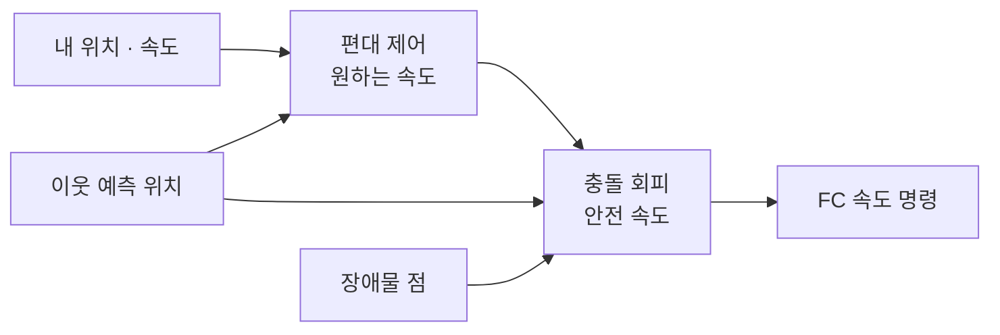

# 편대 제어와 충돌 회피 알고리즘

N6에서 도는 두 알고리즘 묶음을 정리한다. 편대 제어가 "원하는 속도"를 만들고, 충돌 회피가 그것을 "안전 속도"로 고친다. 입출력 위치는 [부품별 연산과 입출력](../하드웨어/03_부품별_입출력과_연산.md) 5.4절. 선정 이유는 [알고리즘 선정 이유](../스토리텔링/04_알고리즘_선정_이유.md), 안전거리 근거는 [알고리즘 선정 이유](../스토리텔링/04_알고리즘_선정_이유.md) 6절.

상태: **채택** = 본 구현 대상 / **비교군** = 실험에서 비교 / **보류** = 조건부



## 1. 편대 제어

대형의 자기 자리로 모이면서 편대 전체가 움직이게 하는 속도를 만든다.

| 알고리즘 | 원리 | 판정 |
| --- | --- | --- |
| **Consensus** | 이웃과의 상대 위치가 대형이 요구하는 상대 위치와 맞도록 서로 당긴다. 중앙 조율자 없음 | **채택 (기본)** |
| Leader-Follower | 리더 위치에 대형 오프셋을 더한 자리를 따라간다 | 비교군 |
| Virtual Structure | 편대를 강체로 보고 각자 자리로 이동 | 비교군 |

### Consensus 계산

```
원하는 속도 = 편대 이동 속도
            + 이웃마다 [ 맞추는 강도 × (실제 상대 위치 − 대형이 요구하는 상대 위치) ] 의 합
```

| 쓰는 값 | 어디서 | 의미 |
| --- | --- | --- |
| 편대 이동 속도 | 목표 (PC에서 배포) | 편대 전체가 가려는 속도 |
| 실제 상대 위치 | 이웃 예측 위치 − 내 위치 | 지금 이웃이 나에게서 얼마나 떨어져 있나 |
| 대형이 요구하는 상대 위치 | 대형 위치 표 (역할 번호별) | 대형이 되려면 이웃이 있어야 할 자리 |
| 맞추는 강도 | 설정값 | 클수록 빨리 모이지만 이웃 정보 오차에 민감 |

- 대형이 이미 맞으면 합이 0이 되어 편대 이동 속도만 남는다.
- 우선순위는 안전 > 편대 유지 > 목표 도달이다. 이 단계는 안전을 보지 않고, 다음 단계가 고친다.
- 목표점으로 가는 편대 이동 속도 산출식은 [제안]이며 확정 전이다.

## 2. 충돌 회피

### 2.1 목록

| 알고리즘 | 원리 | 특징 | 판정 |
| --- | --- | --- | --- |
| **CBF-QP** | 원하는 속도를 안전 조건 아래에서 최소로 보정 | 위험할 때만 개입, 차원 무관 | **채택** |
| APF | 목표 인력 + 이웃 척력 | 가장 가벼움, 지역최소점에 갇힘 | 비교군 |
| ORCA | 속도 공간 반평면 제약, 부담 절반씩 | 2D 전용, 여유 없음 | 비교군 |
| MPC / TinyMPC | 미래 궤적 최적화. TinyMPC는 MCU급 저메모리 솔버 | 무거움 | 비교군 |
| 학습 기반 (GCBF+ 등) | 학습한 정책 | 학습 필요 | 보류 |
| 교착 탐지 · 완화 | 목표에서 먼데 속도가 거의 0인 상태가 계속되면 판정 | 우선순위 · 교란 · 목표 재배정으로 풀기 | 채택 |

### 2.2 CBF-QP 계산

목표: 안전 조건을 모두 지키는 속도 중 원하는 속도에 가장 가까운 것을 고른다.

```
안전 속도 = 아래 조건을 모두 지키는 속도 중 원하는 속도와 가장 가까운 것
  조건 1: 이웃마다 접근 제한
  조건 2: 장애물마다 접근 제한 (장애물 속도는 0)
  조건 3: 속도 크기 ≤ 최대 속도
```

**안전거리**

```
안전거리 = 기본 거리 + 내 위치 오차 + 이웃 위치 오차
         + 상대속도 상한 × 정보 나이 + 시계 오차
```

통신 지연이 클수록, 이웃 정보가 낡을수록 안전거리가 커진다. 값은 약 0.85 ~ 1.15 m이다 [계산, 각 항은 가정값].

**이웃 한 대에 대한 조건**

```
여유 = (이웃과의 거리)² − 안전거리²
조건: (이웃에서 나를 향한 방향) · (내 속도)
      ≥ (이웃에서 나를 향한 방향) · (이웃 속도) − ½ × 여유 감쇠 계수 × 여유
```

- 여유가 크면 조건이 느슨해서 원하는 속도가 그대로 통과한다.
- 여유가 0에 가까우면 이웃 쪽 속도 성분을 이웃 속도 수준까지 눌러 접근을 막는다.
- 여유 감쇠 계수는 클수록 일찍 개입한다(설정값).

**계산 예 (설명용 가정값, 측정값 아님)**

| 항목 | 값 |
| --- | --- |
| 내 위치 | (0, 0) |
| 이웃 예측 위치 | (1.2, 0) |
| 이웃 속도 | (−0.5, 0) |
| 원하는 속도 | (1.0, 0) |
| 안전거리 | 0.85 m |
| 여유 감쇠 계수 | 1 |

```
여유 = 1.2² − 0.85² = 0.7175
이웃에서 나를 향한 방향 = (−1.2, 0)
허용 기준 = (−1.2)(−0.5) − ½ × 1 × 0.7175 = 0.2413
조건: −1.2 × (내 x속도) ≥ 0.2413  →  내 x속도 ≤ −0.201
원하는 속도 (1.0, 0)은 조건을 어긴다
조건을 지키는 속도 중 가장 가까운 것 → 안전 속도 = (−0.201, 0)
```

### 2.3 해가 없을 때와 지연

- 사방이 막혀 조건을 모두 만족하는 속도가 없을 수 있다. 이때 감속 · 정지하고, 교착으로 이어지는지 지표로 센다.
- 속도 명령이 즉시 실현된다고 가정한다. 실제로는 속도 추종 지연 τ만큼 늦어서 안전거리와 최대 속도로 보상한다. τ는 가정 0.2 ~ 1.0 s이고 **실측이 필요하다**.

### 2.4 시뮬 비교 (이상적 조건)

6대가 반지름 2 m 원 위에서 정반대편으로 이동, 안전거리 0.4 m, 최대 속도 1 m/s, 1 cm 노이즈. 지연 없음 · 완벽한 위치 · 속도 가정이다.

| 알고리즘 | 차원 | 최소 이격 | 도달 시간 | 최종 오차 |
| --- | --- | --- | --- | --- |
| APF | 2D | 0.416 m | 8.9 s | 0.000 |
| CBF | 2D | 0.469 m | 10.7 s | 0.000 |
| CBF | 3D | 0.485 m | 9.25 s | 0.000 |
| ORCA | 2D | 0.400 m | 7.7 s | 0.000 |

- 이상적 조건에서는 모두 통과한다. APF가 통과했다고 안전한 것은 아니다. 장애물과 목표가 일직선이면 x = 4.22에서 정지한다(지역최소점 재현).
- ORCA의 0.400은 안전거리에 딱 닿은 값이다. 여유가 없어 τ ≥ 0.5 s에서 침범했다. CBF는 여유 0.1 m를 두어 τ = 1.0 s에서도 최소 이격 0.406 m를 지켰다.
- CBF는 차원 무관이라 3D에 같은 코드를 쓴다. ORCA는 2D 전용이다.
- 파이썬 시뮬 값이며 실기체 성능이 아니다. 시뮬 코드는 학습용 구현(Dykstra 교대 사영)이고 N6용 QP 솔버는 아직 정하지 않았다.
