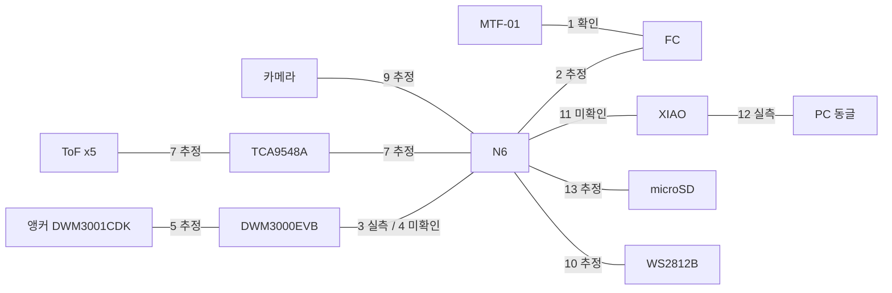

# 센서 연동성

부품 리스트의 부품끼리 실제로 연결되는지 항목별로 판정한다. 근거는 부품 호환성 검토(2026-10)와 벤치 실측(Task 1 ~ 4)이다.

판정: **실측** = 벤치에서 동작 확인 / **확인** = 공식 문서로 가능 확인 / **추정** = 문서상 가능하나 시험 전 / **미확인** = 근거 없음 / **문제** = 막힐 가능성 큼

## 연동 판정 (16개)

| # | 연결 | 판정 | 근거 · 막힌 점 | 해야 할 일 |
| --- | --- | --- | --- | --- |
| 1 | MTF-01 → FC | 확인 | UART 115200 MAVLink. `mav_id` 변경 필요 여부 [미확인] | `FLOW_ORIENT_YAW`, `mav_id`, 하향 센서 `RNGFND1_ORIENT=25` 확인 |
| 2 | N6 ↔ FC | 추정 | UART MAVLink2 가능. STM32N6 + MAVLink 선례 없음. 둘 다 3.3 V라 레벨 문제 없음 | MAVLink C 헤더를 넣고 heartbeat부터. FC `SERIALn_PROTOCOL=2`, 보레이트 460800 이상 |
| 3 | DWM3000EVB → N6 Zio 헤더 | 실측 | SPI로 Device ID 읽기까지 확인(Task 2). 레인징은 아직. EVB 치수 · 무게 [미확인] | 레인징 동작 확인, 무게 실측 |
| 4 | Qorvo DW3XXX API → STM32N6 | 미확인 | 드라이버는 SPI 함수만 구현하면 포팅되는 구조 (일반 지식). N6용 예제 없음. 포팅 중 | HAL SPI · IRQ · 타이머 어댑터 작성 |
| 5 | EVB(태그) ↔ DWM3001CDK(앵커) 측거 | 추정 | 같은 DW3110 계열. 공식 예제 없음. CDK SDK v1.1.1 DS-TWR HardFault 보고 | 채널, 프리앰블, 데이터율, SFD, STS를 일치시키고 앵커 펌웨어를 직접 빌드 |
| 6 | 태그 ↔ 태그 (드론 간 UWB) | 추정 | 거리만 나옴. 6대 + 앵커 3개가 한 채널을 나눠 써 시간 분할 필요 | TDMA 슬롯표 설계 |
| 7 | VL53L1X ×5 → TCA9548A → N6 | 추정 | 멀티플렉서로 주소 0x29 충돌 해결. Pololu 보드 레벨 시프트 내장 | 채널별 응답, 5개 동시 연속 측정 (Task 5) |
| 8 | ToF → FC (DISTANCE_SENSOR) | 추정 | `PRX1_TYPE=2`(MAVLink), orientation으로 방향 구분, 하향(25)은 무시 | FC 회피는 보조 안전장치로만. 실기 공존 시험 |
| 9 | N6 → STEVAL 카메라 | 추정 | ST 커뮤니티에 NUCLEO-N657과 연결 사례. 22핀 FFC 어댑터 필요 여부 [미확인] | DCMIPP로 프레임 캡처 |
| 10 | N6 → WS2812B | 추정 | 3.3 V 신호로 5 V LED 직접 구동 불가 → SN74AHCT125 필요 | 레벨 시프터 경유. 5 V는 FC BEC 또는 보조배터리 |
| 11 | N6 ↔ XIAO nRF52840 | 미확인 | 연결 방식(UART / SPI) 문서 없음. 엔드투엔드는 Task 4 Lv3 대기 | UART 921600 가정으로 시험 |
| 12 | XIAO ↔ PC 동글 (BLE) | 실측 | 처리량 · 손실 · RTT 측정 완료. 20 m에서 4회 중 1회 28.9% 부족 | 드론 ↔ 드론 교환 방식 결정: 동글 중계 / BLE 광고 / UWB 페이로드(시험 전) |
| 13 | N6 → microSD | 추정 | 3 V 전용 보드. 같은 SPI 버스를 UWB와 쓰면 충돌 | 별도 SPI 또는 SDMMC |
| 14 | Zio 헤더 핀 총량 | 미확인 | SPI(UWB) · I2C(ToF) · UART ×2(FC, XIAO) · CSI · SD · LED가 한 보드에 모임. EVB 쉴드가 헤더 점유 | 핀 배정표 먼저 작성 |
| 15 | 보조배터리 → N6 + XIAO + LED + SD | 추정 | 시트 변경으로 기체용 전원 구성 미확정 | 기체용 전원 확정 |
| 16 | 탑재 | 문제 | NUCLEO, EVB 쉴드, 카메라, 뱅크가 3인치급 기체에 무거움. 소형 대안 OpenMV N6 [추정] | 탑재 방식 팀 결정. 연동 시험은 지상 보드로 먼저 |

집계: 실측 2(3, 12), 확인 1, 추정 9, 미확인 3(4, 11, 14), 문제 1(16). 실측으로 동작이 확인된 것은 EVB의 SPI 읽기와 BLE 한 홉뿐이다.

## 연결 상태 지도

가장 위험한 곳은 4(UWB 드라이버 포팅), 5(태그와 앵커 상호운용), 11(N6와 BLE 보드), 14(핀 총량), 16(탑재)이다. UWB가 위치 추정 전체의 전제이므로 3(레인징) · 4 · 5를 먼저 푼다.

## 센서 간 의존성

| 의존 | 내용 | 영향 |
| --- | --- | --- |
| MTF-01 → UWB | 앵커 3개로는 z를 못 구해 UWB 직선거리를 수평거리로 바꿀 때 MTF-01 고도가 필요 | 고도가 흔들리면 위치도 흔들림. 예: 직선거리 1 m, 높이 차 0.5 m이면 수평거리 13 cm 차이 |
| UWB → FC → 이웃 방송 | UWB 위치가 FC EKF에 들어가고, EKF 결과가 이웃에게 방송됨 | 이웃이 받는 위치 품질 = UWB 품질 |
| FC → ToF 처리 | ToF 거리 → 월드 점 변환에 FC 자세가 필요 | 자세 시각과 측정 시각이 맞아야 함 |
| UWB · 통신 → ToF 중복 제거 | ToF가 이웃 드론을 치면 이미 아는 이웃과 같은 물체 | 안 하면 한 대를 두 번 세어 과잉 회피 |
| 시계 → 외삽 · 로그 | 6개 시간 기준(FC, N6, UWB 칩, XIAO, 동글, ZED) | 기준 하나로 환산해야 함 |
