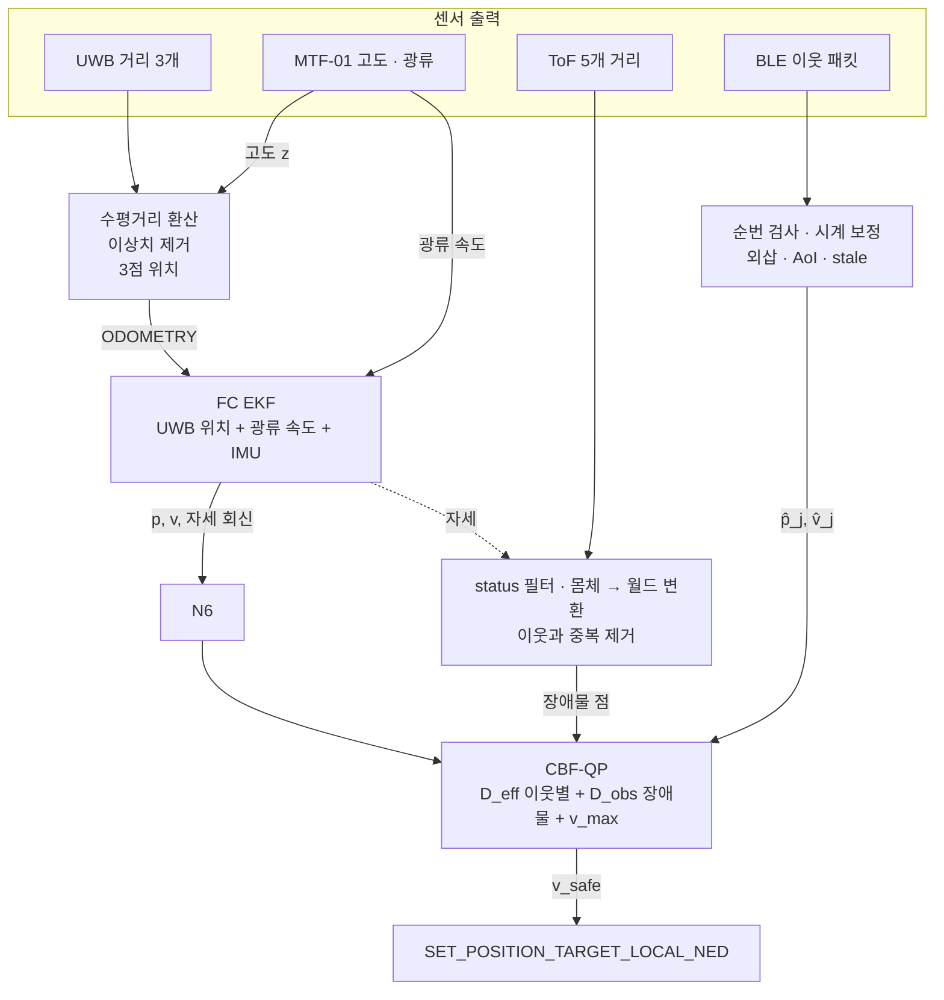
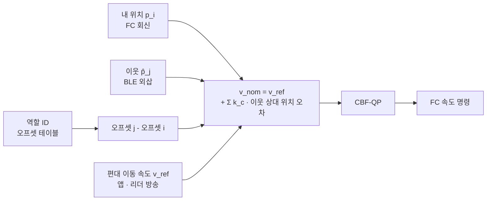

# 센서별 입력 · 출력과 연결

기체 1대 기준, 현재 안(2026-11-02 결정 반영) 부품만 다룬다. 근거 표기: (실측) 벤치 측정, (확인) 문서에 출처가 있는 값, (계산) 산수, (추정), (가정), [미확인].

## 1. 부품별 Output / Input

| 부품 | Output (원시) | Input | 인터페이스 | 갱신율 |
| --- | --- | --- | --- | --- |
| FC DAKEFPV H743 | 자세(roll / pitch / yaw), EKF 위치 · 속도, IMU | UWB 위치(ODOMETRY), 광류, 하향 거리, DISTANCE_SENSOR, 속도 setpoint | UART MAVLink (MTF-01, N6, ELRS 등), UART 8개 (확인) | 위치 · 속도 루프 50 Hz, 자세 250 Hz, 각속도 1 kHz (PX4 기준 확인, ArduPilot 값 [미확인]) |
| MTF-01 | 광류 xy(품질 포함), 하향 거리(고도) | 전원 | UART 115200 MAVLink → FC 직결 (확인) | 최대 100 Hz |
| NUCLEO-N657X0-Q | ODOMETRY, DISTANCE_SENSOR, 속도 setpoint, 이웃 패킷, LED 데이터, 로그 | 아래 모든 센서 + FC 상태 | Zio 헤더, 카메라 FPC. 핀 대응 [미확인] | CBF 20 ~ 50 Hz (가정) |
| DWM3000EVB (태그) | 타임스탬프 → 거리, 수신 진단값(첫 경로 전력 등) | SPI 명령, IRQ | SPI + IRQ + RST | 11 ~ 33 Hz (추정, 아래 5절) |
| DWM3001CDK (앵커) | 응답 프레임 | 5 V 전원 | UWB 무선만 사용 | — |
| VL53L1X (Pololu 3415) | 거리(mm), range_status, 신호율 | I2C 명령, XSHUT | I2C, 주소 0x29 동일. VIN 2.6 ~ 5.5 V | 최대 50 Hz (벤더, short 모드 20 ms) |
| TCA9548A | 채널 전환 | I2C | I2C | — |
| STEVAL-66GYMAI1 (VD66GY) | 원시 프레임 1124 × 1364, 글로벌 셔터 (확인) | I2C 제어, 클럭 | MIPI CSI-2, 22핀 FFC | fps [미확인] |
| WS2812B ×4 (+링 1) | 빛(식별 마커) | 800 kHz 단선 데이터 | N6 GPIO → SN74AHCT125 → LED | 갱신 비용 무시 |
| XIAO nRF52840 | 수신 프레임, RSSI | N6 송신 프레임 | N6와의 연결 방식 **[미확인]**(UART 가정) | 50 Hz × 64 B 손실 0 (실측) |
| microSD 브레이크아웃 (3 V 전용) | 저장 | SPI / SDIO | N6 | 쓰기 지연 불규칙 |
| ZED 2i ×3 (UWB 실패 시 대안, 지상) | 영상 · 깊이 → 마커 위치 | USB 3.0 | PC (NVIDIA GPU) | 해상도별 30 ~ 60 fps (확인) |

## 2. 값 → 사용처

| 값 | 만드는 곳 | 쓰는 곳 |
| --- | --- | --- |
| UWB 위치 (x, y) | 앵커 3 + 태그 + N6 | FC EKF(자기 위치), EKF를 거쳐 이웃 방송 |
| 고도 z | MTF-01 거리(경사 보정) 또는 기압 | UWB 수평거리 보정, ODOMETRY z |
| 속도 v_i | FC EKF (광류 + IMU) | 이웃 방송, CBF의 ḣ 계산(이웃 속도 v̂_j와 짝) |
| yaw | FC(컴퍼스) 또는 외부 [미확인] | 월드(방) ↔ NED 회전, 카메라 방위 변환 |
| 이웃 p̂_j, v̂_j | 무선 패킷 + 외삽 | CBF 제약, 편대 제어 |
| 이웃 거리 d_ij (UWB) | 태그 ↔ 태그 | 통신 위치와 교차검사, 통신 단절 시 CBF 보조 |
| ToF 거리 | VL53L1X | CBF 장애물 제약 + FC 근접 회피(이중 안전층) |
| 카메라 방위 | STEVAL | 보이는 이웃의 위치 보정 (선택, 후순위) |

## 3. 충돌 회피 흐름 (센서 → 안전 필터)

## 4. 편대 제어 흐름

- 이웃 수(인접 리스트)가 적을수록 통신이 줄지만 수렴이 느려진다. 경량화의 트레이드오프다.
- `v_ref`는 모두 안다고 가정한다. 실제로는 앱이 방송하거나 리더를 거쳐 전달한다.

## 5. UWB 갱신율 설계

한 바퀴 시간 = 기체 수 N × (앵커 3 + 이웃 측거 k) × 교환 1회 시간 t_ex (추정).

| 조건 | 한 바퀴 | 기체당 갱신율 |
| --- | --- | --- |
| DS-TWR 1회 1 ~ 3 ms 가정, N = 6, k = 2 | 30 ~ 90 ms | 약 11 ~ 33 Hz |
| 같은 가정, k = 5 (전원) | 48 ~ 144 ms | 약 7 ~ 21 Hz |

참고: Crazyflie 13대 피어 UWB는 16 Hz(확인), Bitcraze TWR은 태그 4개에서 태그당 10 Hz 안팎(확인). ArduPilot 외부 위치는 최소 4 Hz, 권장 30 Hz급(확인). **시간 분할(TDMA) 없이 각자 측정하면 충돌한다.** 슬롯 동기는 동글 비콘으로 맞추는 방안 [제안].

## 6. 시간 순서로 본 데이터 경로

| 단계 | 구간 | 메시지 | 주기 |
| --- | --- | --- | --- |
| 1 | 앵커 ↔ 태그 | UWB TWR 프레임 | 11 ~ 33 Hz (추정) |
| 2 | 태그 → N6 | SPI 타임스탬프 | 이벤트 |
| 3 | N6 → FC | ODOMETRY 약 245 B | 20 ~ 30 Hz |
| 4 | FC → N6 | 융합 상태 | FC 설정 |
| 5 | N6 → XIAO → BLE | 내 상태 64 B | 50 Hz 기준선, 이벤트 트리거로 감소 |
| 6 | BLE → XIAO → N6 | 이웃 상태 64 B | 이웃 수 × 방송 주기 |
| 7 | ToF → N6 | 5개 거리 | 연속 모드, 한 바퀴 약 3 ms 읽기 (계산) |
| 8 | N6 → FC | 속도 명령 약 65 B | 20 ~ 50 Hz |
| 9 | N6 → FC | DISTANCE_SENSOR 약 30 B × 5 | 10 ~ 50 Hz |
