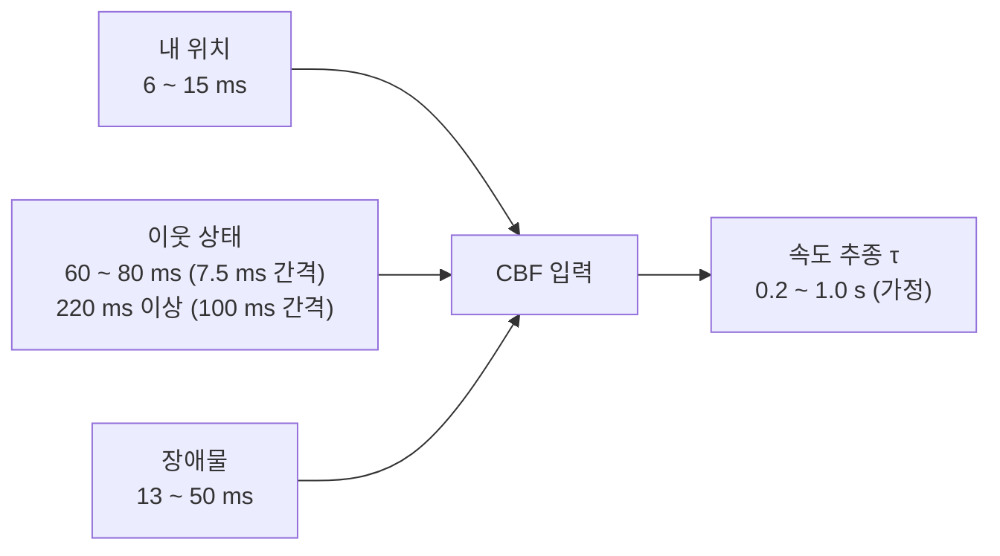

# 지연 분석

센서 출력이 FC 입력이나 CBF 입력에 닿기까지 걸리는 시간이다. 실측은 BLE RTT와 N6 연산 시간뿐이고 나머지는 계산 · 추정 · 가정이다. [측정 계획](#측정-계획)으로 교체해야 한다.

가정: UART 보레이트 921600, 기체 속도 1 m/s(상대 최대 2 m/s), 이웃 방송 20 Hz.

## UART 전송 시간

전송 시간 = 바이트 × 10 비트 / 보레이트 (계산).

| 메시지 (MAVLink2, 오버헤드 12 B 포함) | 크기 | 115200 | 460800 | 921600 |
| --- | --- | --- | --- | --- |
| ODOMETRY (페이로드 약 230 B) | 약 245 B | 21 ms | 5.3 ms | 2.7 ms |
| SET_POSITION_TARGET_LOCAL_NED | 약 65 B | 5.6 ms | 1.4 ms | 0.7 ms |
| DISTANCE_SENSOR | 약 30 B | 2.6 ms | 0.65 ms | 0.3 ms |
| 이웃 패킷 31 B (+프레임) | 약 35 B | 3 ms | 0.8 ms | 0.4 ms |

**보레이트 예산 (계산).** N6 → FC를 30 Hz로 보내면 ODOMETRY 7.4 KB/s + ToF 5개 × 30 Hz 4.5 KB/s + 속도 명령 2.0 KB/s ≈ 13.9 KB/s, 약 139 kbaud 상당이다. **115200 baud로는 모자라고 460800 이상이 필요하다**(약 30% 사용). MTF-01은 FC와 별도 UART라 영향이 없다.

## 체인 A: 내 위치 (UWB → FC)

| 단계 | 지연 | 근거 |
| --- | --- | --- |
| 거리 교환 3회 (앵커 3개 연속) | 3 ~ 9 ms, 평균 시점은 절반 | 추정 (DS-TWR 1회 1 ~ 3 ms 가정) |
| SPI 읽기 + 위치 계산 | < 1 ms | 추정 |
| 평균 필터를 쓰면 | + (N - 1)/2 × 주기. 3점 · 20 Hz에서 50 ms | 계산. 쓰지 않는 것을 권장 |
| ODOMETRY UART 전송 | 2.7 ms (921600) / 21 ms (115200) | 계산 |
| FC 처리 | 지연 파라미터가 맞으면 0 | 파라미터 설정 |
| **합계 (측정 시점 → FC 입력)** | **약 6 ~ 15 ms (권장 설정) / 최악 약 80 ms** | 계산 · 추정 |
| 별도: 갱신 주기 평균 대기 | 주기/2. 20 Hz면 25 ms | 계산 |

## 체인 B: 이웃 상태 (무선 → CBF)

| 단계 | 지연 | 근거 |
| --- | --- | --- |
| 송신 측 대기 (방송 20 Hz) | 평균 25 ms, 최대 50 ms (이벤트 트리거면 T_max까지) | 계산 |
| N6 → XIAO UART | 0.4 ms (921600) / 3 ms (115200) | 계산 |
| 공중 구간 한 홉 (드론 ↔ 동글) | 편도 ≈ RTT/2. 연결 간격 7.5 ms면 약 13 ms, 100 ms면 약 90 ms | **실측 RTT에서 계산** (대칭 가정) |
| 공중 구간 2홉 (드론 → 동글 → 드론) | 약 26 ms (7.5 ms 간격) ~ 180 ms (100 ms 간격). 동글 처리 시간 미포함 | 계산, 엔드투엔드 미측정 |
| XIAO → N6 UART | 0.4 ~ 3 ms | 계산 |
| 외삽 · AoI 계산 | < 0.1 ms | 추정 |
| **합계 (이웃 위치의 나이)** | 간격 7.5 ms 2홉 약 60 ~ 80 ms, 간격 100 ms 약 220 ms 이상 | 계산 |

**연결 간격이 지연을 정한다.** 7.5 ms와 100 ms는 RTT가 7배 차이 난다(실측: 평균 26.0 ms vs 179.8 ms). 이벤트 트리거로 전송 횟수를 줄여도 연결 간격은 짧게 유지한다 [제안].

## 체인 C: 장애물 (ToF → 회피)

| 단계 | 지연 | 근거 |
| --- | --- | --- |
| 측정 예산 | 20 ms(short) / 33 ms(long) 중 평균 시점은 절반 | 일반 지식 |
| 다음 읽기까지 대기 | 0 ~ 예산 | 계산 |
| N6 I2C 읽기 (5개 한 바퀴) | 약 3 ms (400 kHz) | 계산 |
| DISTANCE_SENSOR → FC | 0.3 ms (921600) | 계산 |
| **합계** | short 약 13 ~ 33 ms / long 약 20 ~ 50 ms | 계산 |

1 m/s에서 이 지연 동안 1.3 ~ 5 cm 움직인다(계산). 더 큰 문제는 **감지 거리**다. 속도 추종 지연 τ = 1.0 s에 속도 1 m/s면 멈추기까지 약 1 m를 더 간다(계산, τ는 가정치). short 모드 감지 거리 약 1.3 m는 여유가 거의 없어 `v_max`를 낮춰야 한다. 얇은 막대, 어두운 표면, 반사율 낮은 프롭은 더 짧게 잡힌다.

## 체인 D: 카메라 (후순위)

전부 가정이다. 노출 중간까지 2 ~ 5 ms, 판독 약 10 ms, 캡처 · ISP 버퍼 1프레임(30 fps면 33 ms), 검출 10 ~ 30 ms → **합계 약 60 ~ 110 ms**. 방위를 월드 좌표로 바꿀 때 노출 시각의 자세가 필요해 FC 자세를 N6 링 버퍼에 쌓아 보간한다 [제안].

대안 경로 ZED 2i(UWB 실패 시): 캡처 33 ms(30 fps) + SDK · 깊이 · 마커 검출 수십 ms + 방송 지연으로 추정 80 ~ 150 ms. 하드웨어 동기 트리거가 없어 타임스탬프로 맞춘다.

## 체인 E: 명령 (CBF → 모터)

| 단계 | 지연 | 근거 |
| --- | --- | --- |
| CBF-QP 계산 (6대, 이웃 5) | < 1 ms 수준 | 추정. N6 실측: 12×12 행렬곱 4.7 µs, PID 3축 0.23 µs, 1 kHz 인터럽트 jitter 최악 0.18 µs. **QP 자체는 미측정** |
| 속도 명령 UART | 0.7 ms (921600) | 계산 |
| FC 속도 루프 대기 | 최대 20 ms (50 Hz) | 확인(PX4 기준). ArduPilot [미확인] |
| **속도 추종 지연 τ** | **0.2 ~ 1.0 s** | **가정 (시뮬 입력, 실측 없음)** |

전자 쪽 지연 합이 수십 ms인데 τ는 수백 ms다. **안전 여유 숫자는 τ가 정한다.** 기체 τ 실측이 가장 먼저 필요하다.

## 한눈에 보기

| 체인 | 지연 | 근거 수준 |
| --- | --- | --- |
| 내 위치 | 약 6 ~ 15 ms | 계산 · 추정 |
| 이웃 상태 | 약 60 ~ 220 ms 이상 | 실측 RTT에서 계산 |
| 장애물 | 약 13 ~ 50 ms | 계산 |
| 카메라 | 약 60 ~ 110 ms | 가정 |
| 속도 추종 τ | 0.2 ~ 1.0 s | 가정 (가장 큰 값) |

안전 여유로 환산한 값은 [안전 여유와 실험 설계](../설계/03_안전여유와_실험설계.md)에 있다.

## 측정 계획

| 측정 | 과제 | 교체할 값 |
| --- | --- | --- |
| EVB 태그 레인징, EVB ↔ CDK 상호운용, DS-TWR 1회 시간, 위치 RMSE, z축, 갱신율 | Task 1 Lv3, Task 2 | 체인 A 교환 시간, UWB 갱신율, ε_self |
| CBF-QP 1주기 시간(평균 · p99), NPU · RTOS 동시 부하, 카메라 캡처 지연 | Task 3 Lv3 | 체인 D, E |
| N6 → XIAO → 동글 엔드투엔드, 드론 ↔ 드론 2홉, 재연결 시간, UWB · BLE 동시 간섭, 모터 구동 중 성능 | Task 4 Lv3 | 체인 B 공중 구간 |
| ToF 5개 동시 연속 측정, 주소, 읽기 시간, 모드별 감지 거리 | Task 5 | 체인 C |
| 속도 추종 지연 τ (호버에서 속도 계단 입력) | 기체 시험 | 체인 E τ |
| FC 지연 파라미터에 맞는 값 | 기체 시험 | 체인 A 5번 |

## 확인하지 못한 것

- VD66GY 최대 fps, 노출 · 판독 시간, N6 DCMIPP / NPU 처리 시간.
- ArduPilot Copter의 루프 주파수, 시각 오도메트리 · 광류 지연 파라미터 기본값.
- BLE 확장 광고 지연의 실제 분포.
- VL53L1X 모드별 최소 timing budget, WS2812B PWM 주파수 등 일반 지식 항목.
